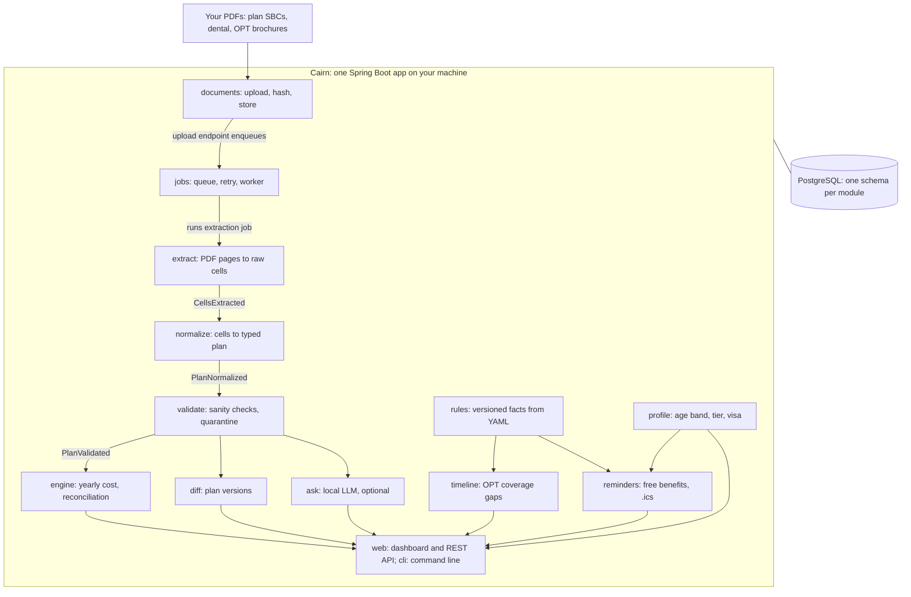
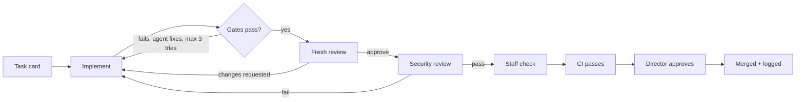

# Cairn: System Architecture & 7-Day Roadmap

Nov 18, 2026 · @Vaishnavi Bhairishetty

**Status:** Approved by the director on Nov 19, 2026, after a three-round Goldfish design
review (final readiness: GO). ADRs 0001 to 0004 are accepted. Open review findings are
carried into the task cards for the day they affect.

**How to read this document.** Sections 1 to 9, 11 and 13 are the product and system design.
Sections 10 and 12 are the build plan, written for the director, who runs the project with a
team of AI agents. The repository rules in `CLAUDE.md` and `.claude/rules/*.md` (architecture,
Java coding, testing, security, data and privacy, git and delivery, AI features) apply in
full and are not repeated here. If this document and those rules disagree, the director
decides and both are updated.

## 1. Overview

Cairn is a free, open-source, self-hosted tool that helps employees choose the right health plan, use the benefits they already pay for, and avoid coverage gaps, with extra guidance for F-1 students on OPT and STEM OPT. Version 1 was planned for 7 days (Thu Nov 19 to Wed Nov 25, 2026), during open enrollment season. On Nov 23 the director moved v0.1.0 to Wed Dec 2, 2026 with the same scope (see section 12).

**The name.** A cairn is a stack of stones hikers build to mark the trail where the path is hard to see. Cairn marks the trail through a health system that is hard to read, especially for someone new to the US. Tagline: *Trail markers for your health coverage.* No health insurance or benefits product using the name was found; the word is used by unrelated companies in other fields.

**The problem, with evidence**

- Employer coverage is the largest group: it covers almost 157 million people under 65 ([KFF](https://www.kff.org/health-costs/issue-brief/2026-employer-health-benefits-survey/)).
- People choose badly: in one study, more than 80% of employees at a Fortune 100 company picked the wrong plan ([Dallas News](https://dallasnews.com/business/health-care/2019/10/30/3-tips-for-choosing-the-right-health-plan-to-match-your-needs)).
- It is expensive: the average yearly cost of choosing the wrong plan was more than $2,000 in a University of Dayton analysis ([US Rx Care](https://usrxcare.com/most-workers-make-bad-health-insurance-decisions/)).
- It is rushed: the average employee spends only 30 to 60 minutes choosing benefits ([US Rx Care](https://usrxcare.com/?p=5463)).

**The extra problems for F-1 students on OPT and STEM OPT**

- The school plan often ends 30 to 60 days after graduation, before the employer plan starts ([GradRight](https://gradright.com/opt-health-insurance-guide-for-international-students-coverage-costs-best-plans/)).
- From January 1, 2027, F-1 holders, including OPT and STEM OPT, cannot get marketplace premium subsidies ([F1Jobs](https://www.f1jobs.io/resources/blog/aca-marketplace-subsidies-end-2027-h1b-f1-opt)); about 1.23 million lawfully present people lose subsidy eligibility in 2027 ([Health Affairs](https://www.healthaffairs.org/do/10.1377/forefront.20260522.447008)). These are background sources. The rule Cairn shows users must cite a primary source (CMS or the Federal Register), see section 5.
- Many international student plans are not ACA compliant, with caps of $100,000 to $500,000 and waiting periods for pre-existing conditions ([International Student Insurance](https://www.internationalstudentinsurance.com/blog/?p=4706)).

**The gap.** Good decision tools exist, but they are sold to employers, such as Jellyvision's ALEX ([Fortune](https://dc.fortune.com/2016/01/05/jellyvision-alex-interactive-software-health-plan)). If your employer did not buy one, you get a stack of PDFs. The only open-source alternative found had 3 stars ([open-coverage](https://awesome.ecosyste.ms/projects/github.com%2Faaln%2Fopen-coverage)). Nothing free and private serves the individual employee, and nothing at all serves the OPT transition. (This is a market claim for the pitch, from a short search, not a design input.)

**Origin story (interview line):** *"I'm an F-1 student. I built Cairn because I was about to make this decision myself and could not find a tool that understood my situation."*

## 2. Users and v1 scope

Version 1 serves every employee with an employer plan, and adds a dedicated path for F-1 students moving to OPT and STEM OPT. Cairn is single-user: one person runs it on their own machine, with exactly one profile and no login.

| Persona | Situation | What Cairn gives them |
| --- | --- | --- |
| New employee | Has 2 to 4 plans and one week to choose | Expected yearly cost per plan, best and worst case, with every number linked to its source line |
| F-1 student graduating to OPT | School plan ends, job and employer plan start later | A coverage timeline that shows uninsured days and the rules that apply on those dates, with sources (general information, not advice) |
| STEM OPT worker changing jobs | Between employers, inside the unemployment allowance | The same timeline plus rule notices with effective dates |
| Any covered person | Does not know what is free | A personal checklist of no-cost preventive care and calendar reminders |

**Features by priority**

| Priority | Feature | Day |
| --- | --- | --- |
| 1 | Upload plan documents (SBC PDFs), extract and normalize them | 2 to 4 |
| 2 | Compare plans: expected, best and worst yearly cost for your usage | 4 to 5 |
| 3 | Free-benefits checklist and reminders as a calendar file (`.ics`) | 5 |
| 4 | "What changed since last year?": rule-by-rule comparison of two versions of the same plan | 5 |
| 5 | OPT coverage timeline and versioned rule notices | 6 |
| 6 | Rule Watcher, basic: a weekly GitHub Actions job that detects changes on rule source pages and opens an issue for human review | 7 |
| Stretch | Email reminders through a local test mail server (Mailpit); the address comes from configuration and is never stored in the database | 5 to 6 |
| Stretch | "Ask Cairn": answers plan questions using only your documents, Cairn's results and the official glossary, with sources and refusals (RAG on pgvector) | 6 |
| Stretch | Red-flag scanner for non-standard international or OPT plan brochures | 6 |
| Later | AI summaries in the Rule Watcher; a full 30-question evaluation set for Ask Cairn | Week 2 |
| Later | In-network provider finder through public insurer directory APIs | Weeks 2 to 4 |

**Out of scope for v1:** live appointment booking (no open data source, see section 9), marketplace plan shopping (HealthCare.gov already does it), user accounts or login of any kind, a Redis cache (ADR 0001), OCR for scanned PDFs, mobile apps, and any immigration or insurance advice.

**Done means**

Items marked *(director check)* are confirmed by the director, not by an automated test. Items marked *(if not cut)* depend on a feature in the cut list (section 13); if the feature is cut, the item is dropped and the release notes say so.

- [ ] *(director check)* This design passed the Elephant-Goldfish review (fresh reviewer agents, section 10) and the director approved it before coding started.
- [ ] A fresh clone starts with `docker compose up` (end-to-end smoke test in CI, on Linux), and *(director check)* on an M1 Mac with 8 GB of RAM, with Ollama off, `docker stats` in the 4 GB Colima VM shows under 1.5 GB used in total after the demo flow.
- [ ] SBCs from at least 3 different insurers extract correctly: for each golden fixture, every field in its hand-checked golden JSON (limits, cost rules for every service row and network, coverage-example totals) matches exactly. Golden fixtures are chosen or the grammar is extended so that every row used by a coverage example parses; a golden fixture has no review items on those rows.
- [ ] For every golden SBC, each of its coverage examples simulated by Cairn matches the total printed in the SBC within $50 per example, with status `match` (section 6). An `unmappable` or `mismatch` result on a golden SBC fails this item; it is fixed, never waived.
- [ ] Every money value in the API and dashboard carries a `SourceRef` (section 4): a document cell (page and text), a value the user entered, a labeled price assumption with its source, or a computed value whose breakdown lines each carry one. An API test checks that every money value in a comparison response has a non-empty `SourceRef`.
- [ ] The diff of two years of the same plan (a public pair, or a synthetic second year) lists every changed rule with the right change category (section 7).
- [ ] The OPT timeline test case (school plan ends 2027-06-30, employer plan starts 2027-09-01) reports 62 uninsured days and shows the 2027 subsidy rule with its primary source.
- [ ] The `.ics` export parses with iCal4j in a test, and *(director check)* imports into Apple Calendar.
- [ ] *(if not cut)* The Rule Watcher opens an issue in a test run when an allowlisted fixture page changes.
- [ ] Every merge passed the required CI checks (section 11) and has a security review result in its pull request.
- [ ] Every threat in `docs/threat-model.md` that applies to a shipped feature has a passing test, and no High findings are open (severity scale in `.claude/rules/security.md`).
- [ ] CI is green on `main`; v0.1.0 is tagged with a published Docker image.
- [ ] *(director check)* `docs/ai-workflow.md` records every agent task, what was rejected, and at least 3 bugs caught in review.
- [ ] *(director check)* Three F-1 classmates tried a build by Day 6 and their feedback is recorded in an issue (without personal data).

## 3. Why the data is messy

The Summary of Benefits and Coverage (SBC) is federally required to follow one outline, but every insurer prints it differently, and the cost rules inside it are written in free text.

| Problem | Example | How Cairn handles it |
| --- | --- | --- |
| Same outline, different layouts | SBCs are federally mandated, but carrier implementations vary in layout and terminology ([Sensible](https://www.sensible.so/doc-types/summary-of-benefits)) | The locator finds sections by their required questions and headings, not by page position |
| Costs written as sentences | "$30 copay/visit; deductible does not apply", "20% coinsurance after deductible", "No charge", "Not covered" | A small cost-sharing grammar parses each cell into a typed rule (see the supported forms below) |
| Two or three network columns | In-network, out-of-network, and sometimes a preferred tier | Each column becomes a separate rule tagged with its network |
| Individual and family amounts in one cell | "$1,500 individual / $3,000 family" | Split into separate limits per tier (individual, family) |
| Tables split across pages | The services table usually runs over 4 to 6 pages | Rows are stitched by matching the repeated header |
| Footnotes that change meaning | "Limited to 20 visits per year", "Preauthorization required" | Kept as limitation notes on the rule and shown to the user; the v1 engine does not apply visit caps (section 6) |
| Dental and vision are separate | Dental plans have no federal summary format | Free-text extraction with low confidence, so every value goes to the review screen; if this is cut, the user types the values in by hand |
| International and OPT plan brochures | Often not ACA compliant, with policy maximums and pre-existing waiting periods ([International Student Insurance](https://www.internationalstudentinsurance.com/blog/?p=4706)) | The red-flag scanner looks for these specific terms and warns (stretch goal) |
| Scanned PDFs | A page image with no text layer | Not supported in v1: if the PDF averages fewer than 50 text characters per page, the job fails with error code `needs_ocr` and the UI says why |
| Not an SBC | A brochure uploaded as `sbc` | If the locator finds fewer than 2 of the 3 required SBC headings ("Important Questions", "Common Medical Event", "Coverage Examples"), the job fails with `not_an_sbc` |
| Rules change over time | The F-1 marketplace subsidy rule changes on Jan 1, 2027 | Rules are stored as data with effective dates and sources, never hard-coded |
| Users guess their usage | "Maybe 3 doctor visits?" | Cairn shows low, expected and high scenarios instead of one false-precise number |

**Cost-sharing grammar, supported forms in v1.** Each form becomes one typed rule. Anything else is quarantined with reason `unknown_phrase`, never mapped to a default.

| Form | Example | Typed rule |
| --- | --- | --- |
| Free | "No charge", "$0", "No charge; deductible does not apply" | `free`, `deductible_applies = false` |
| Free after deductible | "No charge after deductible" | `free`, `deductible_applies = true` |
| Copay, deductible does not apply | "$30 copay/visit; deductible does not apply" | `copay`, `deductible_applies = false` |
| Copay after deductible | "$50 copay after deductible" | `copay`, `deductible_applies = true` |
| Coinsurance after deductible | "20% coinsurance", "20% coinsurance after deductible" | `coinsurance`, `deductible_applies = true` |
| Coinsurance, deductible does not apply | "20% coinsurance; deductible does not apply" | `coinsurance`, `deductible_applies = false` |
| Copay plus coinsurance | "$250 copay then 20% coinsurance", "$250 copay/admission plus 20% coinsurance" | `copay_plus_coinsurance`, `deductible_applies = true` unless the cell says the deductible does not apply |
| Not covered | "Not covered" | `not_covered` |

The full phrase table, with real phrases from the fixtures, lives in the parser's tests (`.claude/rules/testing.md`).

**Built-in answer key.** Every SBC must include coverage examples: worked totals for standard scenarios (having a baby, managing Type 2 diabetes, a simple fracture) ([BrightFire](https://clients.brightfire.com/article/how-to-read-summary-benefits-coverage/)). Cairn runs the same scenarios through its own engine and compares the result with the totals printed in the document (section 6). If they disagree, either the extraction or the engine is wrong, and the plan is flagged.

**Rule of the system:** a value that fails validation is never used silently. It is quarantined with its reason, or shown to the user to confirm.

## 4. Architecture

Cairn is a modular monolith that runs entirely on the user's own machine: one Spring Boot app, one Postgres database, and strict internal modules enforced by Spring Modulith. Uploaded documents are processed by a background worker, and every number the user sees comes from a validated, source-linked record.



Each module keeps its data in its own Postgres schema and reaches other modules only through their public API (section 5 and `.claude/rules/architecture.md`). Values that fail validation go to quarantine or the review screen, never into estimates. Nothing about the user leaves the machine; the optional LLM only explains numbers and cited text it is given, and never calculates (section 9, decision 4).

**How the pipeline runs.** The upload endpoint (in `web`, and the same use case in `cli`) asks `documents` to store the file, then asks `jobs` to enqueue an extraction job for that document. Enqueuing is idempotent (one job per type and document), so a crash between the two calls is fixed by uploading the same file again. The `jobs` worker runs the job by calling the `JobHandler` that `extract` provides (ADR 0003). The handler parses the PDF outside any transaction (under the 30-second timeout), then opens one transaction, replaces the document's `raw_cell` rows and publishes `CellsExtracted`. `normalize`, `validate` and `engine` react in turn (`PlanNormalized`, `PlanValidated`) with synchronous listeners in the same transaction. So when a job is `done`, the plan, its review items and its reconciliation all exist. If any step throws, the whole transaction rolls back, the old data stays as it was, and the job is retried by `jobs`. Events carry IDs only, never document text, and every listener is idempotent. No event publication registry is used.

**Pipeline status shown to the user.** `web` composes it from two public APIs: the job's status from `jobs`, and the plan's open review items from `validate`. The result is queued, running, failed (with the job's error code), needs_review (job done, open review items), or done (job done, no open review items).

**Re-running extraction** (after a parser fix, `POST /api/v1/documents/{id}/reextract`) re-queues the document's existing job (attempts reset to 0). The new run replaces that document's `raw_cell` rows and its plan in one transaction; `raw_cell` rows are never updated, only replaced as a set. The user's confirmations and corrections are kept by key (service, network, or limit kind, tier and network). One is re-applied automatically when the new cell's text equals the old one. Otherwise it becomes a review item that shows the old correction next to the new text.

**Shared types.** `common` holds the value types several modules use: `Money`, `SourceRef`, `Service` (the SBC service rows, section 5), `Network`, `LimitTier` and `CoverageTier`. `SourceRef` has four kinds: `document_cell` (a `raw_cell` id), `user_entered` (the field and when it was entered), `assumption` (a price assumption and its source), and `computed` (the breakdown lines it was built from). `validate` exposes the validated plan as `ValidatedPlan` (limits, cost rules, premiums and coverage examples, each with a `SourceRef`), built from `normalize` data. The engine reads only that. `engine` exposes `UsageProfile`, `PriceAssumptions` and `Estimate`. `jobs` exposes `JobHandler`, `JobContext` and `JobResult`.

| Module (Java package `app.cairn.<module>`) | Job | Key technique you will learn |
| --- | --- | --- |
| `common` | Shared value types (`Money`, `SourceRef`, `Service`, `Network`, `LimitTier`, `CoverageTier`) | Immutable records, no Spring and no database |
| `documents` | Upload, store and fingerprint PDFs | Multipart upload, SHA-256 dedupe, file storage behind an interface |
| `jobs` | Runs extraction in the background | Postgres queue with `FOR UPDATE SKIP LOCKED`, retries with backoff, leases, job status the UI can poll |
| `extract` | Finds SBC sections and pulls table cells | PDFBox text extraction, Tabula table detection, header stitching across pages |
| `normalize` | Turns cell text into a typed plan | A small parser for cost-sharing phrases, money parsing, network and tier splitting |
| `validate` | Checks plans before use | Sanity checks (out-of-pocket max at least the deductible), quarantine, review items |
| `engine` | Estimates yearly cost per plan and scenario; reconciles coverage examples | Pure, deterministic Java with `BigDecimal`; the most tested module. Reconciliation lives here because it runs the engine, and `validate` cannot depend on `engine` without a cycle. |
| `diff` | "What changed since last year?" | Matching rules across two plan versions by service and network, then classifying each change |
| `rules` | Versioned facts with effective dates and sources | Rules as data (YAML loaded into Postgres at startup), "as of date" queries |
| `profile` | The one local profile: age band, coverage tier, optional visa category | A tiny module with one row (ADR 0002) |
| `timeline` | OPT coverage-gap checker | Date-range arithmetic with `java.time`, overlap and gap detection |
| `reminders` | Free-benefits checklist and reminders | `.ics` calendar export with iCal4j; email over SMTP is a stretch goal |
| `ask` (stretch) | Answers plan questions with sources | RAG: chunking, embeddings in pgvector, retrieval, a local LLM, guardrails that block numbers not found in the sources, and refusals |
| `web` | REST API under `/api/v1` and the Thymeleaf dashboard | Spring MVC, OpenAPI, Thymeleaf + Chart.js, Spring Security |
| `cli` | Command line | picocli; runs the same jar without the web server and calls module APIs directly, never over HTTP |
| Rule Watcher (outside the app) | Weekly check of rule source pages | A scheduled GitHub Actions workflow that hashes and diffs public pages and opens an issue; humans approve every rule change |

Allowed dependencies between modules are listed in `.claude/rules/architecture.md`. This design adds three (ADRs 0002 to 0004): `reminders` may use `profile`, `extract` may use `jobs`, and `engine` may use `rules` (for the coverage-example claims and the seed price assumptions).

**Delete everything** is run by `web` and `cli`. They ask `jobs` to pause the worker and wait up to 60 seconds for a running job to finish (the parse timeout is 30 seconds). If a job is still running, the request fails with `409` and nothing is deleted. Otherwise they call each module's `deleteAll()` in its public API and resume the worker.

**Three contracts that other modules build against** (task cards give the full signatures):

- `engine`: `CostEngine.estimate(ValidatedPlan plan, UsageProfile usage, CoverageTier tier, PriceAssumptions prices) -> Estimate`. These are records. `Estimate` holds the total, premiums, the share counted toward the maximum, the share not covered, the HSA credit, a list of lines (each with a `SourceRef`), and a list of services the plan has no rule for.
- `UsageProfile`: a map from `Service` (the SBC service rows, section 5) to a yearly count, plus a network (in-network by default). The CLI flags in section 7 map onto it.
- The Cairn plan format: the normalized plan as JSON, described by `src/main/resources/schema/cairn-plan-v1.json`. Golden files follow it. Its first version is written in the Day 1 golden JSON task.

**Tech stack and the reason for each choice**

| Choice | Why |
| --- | --- |
| Java 21 + Spring Boot 4.1 + Maven (ADR 0005) | Builds on the Java you know; Maven matches your tutorial |
| Spring Modulith | Turns the modular monolith into a rule the build checks: no reaching into other modules' internals, no cycles |
| PostgreSQL 16 + Flyway + pgvector | One store for data, provenance, rules, the job queue and the embeddings for Ask Cairn; a schema per module; versioned migrations |
| Apache PDFBox 3 + Tabula-java | Mature Java PDF libraries |
| Thymeleaf + Chart.js + Spring Security | A usable, safe UI in a day, without learning React this week |
| iCal4j | Standard-compliant `.ics` calendar files |
| springdoc-openapi | OpenAPI docs for the REST API |
| JUnit 5, AssertJ, Mockito, Testcontainers | The full test pyramid with a real Postgres, plus property-based tests for the engine |
| Spotless (Google Java Style) + Error Prone | Consistent formatting and compile-time bug detection on every build |
| CodeQL, Dependabot, secret scanning, Trivy | Free automated security checks on every pull request and image |
| GitHub Actions + GHCR | CI on every pull request, the weekly Rule Watcher, and a Docker image on each release tag |
| Docker Compose on Colima | One command to run everything, lighter than Docker Desktop on 8 GB |
| Mailpit (stretch only) | A local test mail server for the email reminder stretch goal; started only under a compose profile |
| Ollama: a small chat model (1B to 3B) and a small embedding model, off by default | Free, local and private; runs natively on the M1 |
| Claude Code + the Elephant-Goldfish Model plugin + `/security-review` | Design drafting and fresh-context reviews before code, bounded coding tasks you review, and an AI security pass on every change (sections 10 and 11) |

Redis was removed from v1 (ADR 0001): the engine is fast, and the `estimate` table already keeps results.

**Memory budget (approximate):** inside the Colima VM (capped at 4 GB): Postgres with pgvector 0.3 GB, the app 0.5 to 1 GB, Mailpit 0.05 GB only if the email stretch ships. Outside the VM, natively on macOS: Ollama with a 3B chat model and a small embedding model, about 3 GB, optional and off by default. Under 1.5 GB in the VM; under 5 GB for the whole machine with everything on.

## 5. Data model

The database keeps raw extractions separate from the typed plan rules built from them, so every rule can be traced back to the exact text in the PDF, and a parser fix can be applied by re-running extraction.

**Conventions.** IDs are `uuid`. Money is `numeric(12,2)`, rates are `numeric(5,4)` (0.2000 = 20%), timestamps are `timestamptz`. Each module's tables live in its own schema with migrations in `src/main/resources/db/migration/<module>/`. Foreign keys exist only inside one schema. A reference to another module's row is a plain ID column (suffix `_id`), resolved through that module's API, never by a join across schemas. Enum columns are `text` with a check constraint. One Flyway instance manages every schema: `spring.flyway.schemas` lists all module schemas, `spring.flyway.locations` lists every module folder, each migration uses schema-qualified names, and versions are timestamps so they stay unique across folders (`V202611191400__documents_create_document.sql`).

**User data and reference data.** The `rules` schema and the seed values in `engine.price_assumption` are reference data shipped with Cairn. Every other table holds user data. "Delete everything" removes all user data, resets `price_assumption` to its seed values, and leaves `rules` untouched.

**`documents` schema**

| Table | Columns | Notes |
| --- | --- | --- |
| `document` | `id`, `kind` (sbc, dental, vision, brochure), `sha256 char(64) unique`, `bytes bigint`, `page_count int`, `storage_name text`, `uploaded_at` | `storage_name` is generated; the user's file name is never stored or used in a path |

**`jobs` schema**

| Table | Columns | Notes |
| --- | --- | --- |
| `job` | `id`, `type` (extract), `document_id`, `status` (queued, running, done, failed), `attempts int`, `next_run_at`, `locked_at`, `locked_by`, `last_error_code text`, `created_at`, `updated_at` | Unique (`type`, `document_id`); index on (`status`, `next_run_at`). `last_error_code` is a code, never document text |

**`extract` schema**

| Table | Columns | Notes |
| --- | --- | --- |
| `raw_cell` | `id`, `document_id`, `page int`, `section` (header, important_questions, services, excluded_services, coverage_examples, other), `row_idx int`, `col_idx int`, `raw_text text`, `bbox jsonb` | Immutable. Exactly what the PDF said, and where. Index on `document_id` |

**`normalize` schema**

| Table | Columns | Notes |
| --- | --- | --- |
| `plan` | `id`, `document_id null` (null for a plan entered by hand), `kind` (medical, dental, vision), `insurer`, `name`, `plan_type` (HMO, PPO, EPO, POS, HDHP), `plan_year int`, `coverage_start date`, `coverage_end date`, `premium_per_paycheck numeric null`, `paychecks_per_year smallint null` (12, 24, 26 or 52), `employer_hsa_contribution numeric default 0` | Premiums and the HSA contribution are typed by the user from the employer's rate sheet. A plan with no premiums can be viewed but not compared |
| `plan_limit` | `id`, `plan_id`, `kind` (deductible, oop_max), `tier` (individual, family), `network` (in_network, preferred, out_of_network), `amount numeric null`, `unlimited boolean`, `source_cell_id`, `confidence`, `status` | `unlimited = true` when the SBC states no limit; `amount` is then null |
| `cost_rule` | `id`, `plan_id`, `service`, `network`, `type` (copay, coinsurance, copay_plus_coinsurance, free, not_covered, unparsed), `copay numeric null`, `coinsurance_rate numeric null`, `deductible_applies boolean`, `limits_note text`, `source_cell_id null`, `confidence`, `status` | Unique (`plan_id`, `service`, `network`). `unparsed` rules become review items in `validate`. `source_cell_id` is null only for values entered by hand (status `user_entered`) |
| `coverage_example` | `id`, `plan_id`, `scenario` (having_baby, managing_diabetes, simple_fracture), `printed_total_example_cost`, `printed_deductible`, `printed_copays`, `printed_coinsurance`, `printed_not_covered`, `printed_total` (all `numeric`), `source_cell_id` | What the SBC printed for each coverage example. `printed_total` is "the total the patient would pay"; `printed_total_example_cost` is the cost of the care before insurance |

`service` is one of the SBC template's service rows: `primary_care`, `specialist`, `preventive`, `diagnostic_test`, `imaging`, `generic_rx`, `preferred_brand_rx`, `non_preferred_brand_rx`, `specialty_rx`, `outpatient_facility`, `outpatient_physician`, `er_facility`, `er_physician`, `emergency_transport`, `urgent_care`, `hospital_facility`, `hospital_physician`, `mental_health_outpatient`, `mental_health_inpatient`, `prenatal_postnatal_office`, `childbirth_professional`, `childbirth_facility`, `home_health`, `rehabilitation`, `habilitation`, `skilled_nursing`, `durable_medical_equipment`, `hospice`, `child_eye_exam`, `child_glasses`, `child_dental_checkup`, and for dental and vision plans `dental_preventive`, `dental_basic`, `dental_major`, `vision_exam`, `vision_lenses`. The engine processes events in this order (section 6). Dental and vision plans use the same `plan` and `cost_rule` tables with `kind` dental or vision. They are not part of medical cost comparisons in v1. The free-benefits checklist offers "dental cleanings" when a dental plan has a `dental_preventive` rule of type `free`.

`confidence` is `numeric(3,2)` from 0 to 1. A clean grammar match in a table cell is 1.00, a match after removing a footnote is 0.80, and free-text extraction (dental, vision) is 0.50. Any value below 0.90 becomes a review item. `status` is one of `extracted`, `user_confirmed`, `user_corrected`, `user_entered`. A corrected value keeps its `source_cell_id` and is marked as changed by the user in the UI.

A new version of the same plan is a separate `plan` row (a new SBC, often a new `plan_year`). `diff` compares two plans the user picks; Cairn suggests pairs with the same insurer and name.

**`validate` schema**

| Table | Columns | Notes |
| --- | --- | --- |
| `review_item` | `id`, `plan_id`, `target_kind` (cost_rule, plan_limit, coverage_example), `target_id`, `reason_code` (low_confidence, unknown_phrase, oop_below_deductible, missing_required_row, out_of_range, correction_needs_recheck), `status` (open, resolved), `created_at`, `resolved_at` | One table for quarantined and low-confidence values; a quarantined value is a review item whose reason is not `low_confidence`. The raw text stays in `raw_cell`; it is not copied |

A review item is resolved through the `validate` API (`PATCH /api/v1/review-items/{id}`). `validate` writes the confirmation or correction to the target row through the `normalize` API, then marks the item resolved. A correction body matches the target: for a cost rule, `type`, `copay`, `coinsuranceRate` and `deductibleApplies`; for a limit, `amount` or `unlimited`. Missing in-network deductible or out-of-pocket rows are `missing_required_row` items. A plan with an open item of any reason other than `low_confidence` cannot be compared until the item is resolved.

**`engine` schema**

| Table | Columns | Notes |
| --- | --- | --- |
| `price_assumption` | `service`, `typical_price numeric`, `source text`, `user_edited boolean` | Typical prices before insurance, labeled as estimates; seeded from `rules.price_seed`, editable by the user |
| `estimate` | `id`, `plan_id`, `scenario` (low, expected, high, worst), `input_hash char(64)`, `total numeric`, `breakdown jsonb`, `computed_at` | Unique (`plan_id`, `scenario`, `input_hash`). `input_hash` is the SHA-256 of the plan's rules and premiums, the usage, the price assumptions and the tier, so any change to an input produces a new row and a stale result is never shown |
| `reconciliation` | `id`, `plan_id`, `scenario`, `engine_total`, `printed_total`, `difference`, `status` (match, mismatch, unmappable), `computed_at` | One row per coverage example |

**`rules` schema** (loaded from `src/main/resources/rules/*.yaml` at startup, read-only)

| Table | Columns | Notes |
| --- | --- | --- |
| `rule` | `id`, `code`, `applies_to` (for example `F-1`), `statement`, `effective_from date`, `effective_to date null`, `source_url`, `verified_on date` | Legal and policy facts. `source_url` must be a primary source (a CMS, IRS, USCIS, DHS or Federal Register page). Null `effective_to` means "still in effect" |
| `preventive_service` | `code`, `name`, `age_bands text[]`, `depends_on_sex boolean`, `frequency` (once, yearly, every_2_years, every_3_years, every_5_years, every_10_years), `source_url`, `effective_from`, `verified_on` | USPSTF A and B recommendations, the source of the free-benefits checklist |
| `age_band` | `code`, `min_age`, `max_age` | Bands chosen at the USPSTF age thresholds, kept as data |
| `coverage_example_claim` | `scenario`, `line`, `service`, `quantity int`, `allowed_amount numeric`, `source_url`, `effective_from` | The standard claims behind each SBC coverage example, published by CMS (section 6). The orchestrator finds and cites them in the Day 1 task T-007 |
| `price_seed` | `service`, `typical_price numeric`, `source_url`, `effective_from`, `verified_on` | Seed values for `engine.price_assumption`. Each price cites a public source chosen in the price-assumption task card, and the director approves the source |

**`profile` schema**

| Table | Columns | Notes |
| --- | --- | --- |
| `profile` | `id smallint primary key check (id = 1)`, `age_band`, `coverage_tier` (self, self_spouse, self_children, family), `visa_category null` | One row, created by the first `PUT /api/v1/profile`; until then `GET` returns `404` and comparisons return `422` asking for the profile. `visa_category` (F-1 or none) is optional; when it is F-1, the timeline shows rules whose `applies_to` is F-1. No name, birth date, sex, SSN, member ID or medical history |

**`timeline` schema**

| Table | Columns | Notes |
| --- | --- | --- |
| `timeline_event` | `id`, `kind` (graduation, school_plan_end, opt_start, job_start, employer_plan_start, other_coverage_start, other_coverage_end), `date` | Inputs to the OPT gap checker, saved with `PUT /api/v1/timeline/events` (the whole set is replaced). These dates are personal data. The CLI `timeline` command does not save anything |

**Timeline date rules.** A coverage period includes both its start and its end date. An uninsured day is any day after the first coverage end (`school_plan_end`) and before `employer_plan_start` that no other coverage period (`other_coverage_start` to `other_coverage_end`) contains. Example: school plan ends 2027-06-30, employer plan starts 2027-09-01, giving 62 uninsured days (July 1 to August 31). `graduation`, `opt_start` and `job_start` are shown on the timeline and used to pick the rules in effect; they do not open or close coverage.

**`reminders` schema**

| Table | Columns | Notes |
| --- | --- | --- |
| `reminder` | `id`, `benefit_code`, `due_on date`, `channel` (ics; email only if the stretch ships), `created_at`, `sent_at null` | No email address is stored. `sent_at` is used only by the email stretch. The user picks `due_on` (default: 30 days from today, using the injected `Clock`). In the `.ics` file, an item with a repeating `frequency` gets a yearly `RRULE` with the matching `INTERVAL` |

**`ask` schema (stretch)**

| Table | Columns | Notes |
| --- | --- | --- |
| `chunk` | `id`, `document_id`, `raw_cell_ids uuid[]`, `text`, `embedding vector(n)` | Retrieval chunks for Ask Cairn. `n` is the dimension of the embedding model chosen in the Ask Cairn task card. The HealthCare.gov glossary is stored as chunks with no `document_id` |

**Rules the schema enforces**

- Money is `NUMERIC` in the database and `BigDecimal` in Java, never `double`.
- Every extracted `cost_rule`, `plan_limit` and `coverage_example` points to a `raw_cell`, which is the provenance chain shown in the UI. Values entered by hand have no `raw_cell` and are labeled "entered by you".
- A `rule` is never edited in place when the law changes: a new row with a new `effective_from` is added, so Cairn can answer "what applied on this date?"
- At startup, rule data is rejected if any rule lacks a `source_url`, or if two rules with the same (`code`, `applies_to`) have overlapping date ranges (a null `effective_to` counts as open-ended).
- Rules carry a `verified_on` date. The UI shows it, and a rule not re-verified within 90 days is marked as needing review. On an old install this flag also tells the user to update Cairn, because updated rules ship only in new releases.

## 6. Cost engine and how we prove it is correct

The engine is a pure function: plan rules, a usage scenario, a coverage tier and price assumptions in; a yearly cost with a line-by-line breakdown out. It does no I/O, which makes it fast and easy to test exhaustively. It reads only validated plans, through the `validate` API.

**The algorithm**

```
premiums   = premium_per_paycheck * paychecks_per_year
limits     = the individual limits for tier "self", the family limits for any other tier
ded_left   = limits.deductible(network)          # 0 if none
oop_left   = limits.oop_max(network)             # "no maximum" if unlimited or absent
counted    = 0                                    # counts toward the out-of-pocket maximum
not_counted = 0                                   # "not covered": never capped

for each event, in order:     # scenarios: the Service enum order of section 5, then count
                               # reconciliation: the CMS claim line order
    price = event.price          # the price assumption, or the CMS claim amount in reconciliation
    rule  = plan.rule(event.service, network)
    if service is preventive and network is in_network or preferred: share = 0      # step 1, wins over a missing rule
    else if rule is missing: record the service as "no rule", skip the event, mark the estimate incomplete
    else switch rule.type:
        not_covered: not_counted += price; continue                               # step 6
        free:
            if not rule.deductible_applies: share = 0
            else: share = deductible_part(price)
        copay:
            if not rule.deductible_applies: share = min(copay, price)             # step 2
            else: share = deductible_part(price) + min(copay, rest)               # steps 3, 4
        coinsurance:
            if not rule.deductible_applies: share = rate * price
            else: share = deductible_part(price) + rate * rest                    # steps 3, 4
        copay_plus_coinsurance:
            base  = deductible_part(price) if rule.deductible_applies else 0; rest = price - base
            share = base + min(copay, rest) + rate * max(rest - copay, 0)
    share = round_half_up_to_cents(share)
    share = min(share, oop_left); oop_left -= share; counted += share             # step 5

deductible_part(price): part = min(price, ded_left); ded_left -= part; rest = price - part; return part

total = premiums + counted + not_counted - employer_hsa_contribution   # may be negative
```

The hand-calculated cases and the golden tests use the same event order. A negative total (the HSA contribution is larger than all costs) is shown as is, labeled "net gain", and never clamped to zero. `preferred` counts as in-network for step 1 and is a separate network everywhere else; `UsageProfile` defaults to `in_network`.

**Incomplete and unconfirmed plans.** An `Estimate` with services that have no rule has `complete = false` and lists them. In the comparison response and the dashboard, such a plan is shown with a visible "incomplete: no rule for <services>" banner and is never ranked or described as cheaper than a complete plan. A plan with open blocking review items (section 5) is not compared at all. Values that are only `low_confidence` and not yet confirmed are used to compute the estimate, but the plan is shown with a "needs review: N values not yet confirmed" flag linking to the review screen. Like an incomplete plan, it is never ranked or described as the best plan until the user confirms those values.

**The six steps in words**

1. In-network preventive care costs $0.
2. A copay that does not wait for the deductible is charged as the copay (never more than the price).
3. While the deductible is not met, you pay the price until it is met. One event can span the deductible: you pay the part that finishes the deductible, and the rest of that event is charged as in step 4.
4. After the deductible: the copay, the coinsurance rate times the price, or the copay and then the rate on what is left.
5. Everything you pay in steps 2 to 4 counts toward the out-of-pocket maximum, and the running total stops growing once it reaches the maximum.
6. "Not covered" services count in full and do not count toward the maximum.

Only the deductible part of a payment reduces the deductible; copays and coinsurance do not. The employer HSA contribution is subtracted in every scenario of a plan that has one (the user enters 0 for plans without an HSA). If `premium_per_paycheck` or `paychecks_per_year` is missing, the plan cannot be compared and the UI asks for them.

**Scenarios shown for every plan**

| Scenario | Usage |
| --- | --- |
| Low | Half of each expected count, rounded down |
| Expected | The user's answers (`UsageProfile`) |
| High | Twice each expected count, plus one emergency room visit (`er_facility` and `er_physician`) |
| Worst case | Not simulated: premiums plus the in-network out-of-pocket maximum, minus the HSA contribution. If the plan states no in-network maximum (`unlimited`), there is no worst-case number; Cairn shows "no maximum" instead. "Not covered" services and out-of-network care can cost more, and Cairn says so plainly |

**Known simplifications in v1, shown in the UI:** embedded family deductibles (the family aggregate is used), visit caps and other limitation notes (shown but not applied), drug costs beyond the four SBC drug rows, copays that count toward the deductible on some plans, and network-specific prices. Typical service prices are labeled estimates the user can edit.

**Coverage-example reconciliation.** SBC coverage examples are computed from standard claims that CMS publishes for each scenario (the claims, their services and allowed amounts). Cairn stores those claims as rule data (`coverage_example_claim`), with each claim mapped to one SBC service row. For each plan and scenario, the engine runs the claims (each line `quantity` times at its `allowed_amount`, in claim line order) with the plan's rules and coverage tier "self", leaves out premiums and the HSA contribution, and compares its total with the SBC's `printed_total` (what the patient would pay). A difference of $50 or less per scenario is a `match`. A larger difference is a `mismatch`. A claim that cannot be mapped to a service row is `unmappable`. A mismatch or unmappable result flags the plan in the UI with the numbers side by side. It is never hidden, and price assumptions are never tuned to make it match. A claim whose service has no parsed rule in the plan makes that scenario `unmappable`. *Assumption to confirm on Day 1 (task T-007): the CMS claim data is published and can be cited.* The criterion stays strict. Work stops and escalates to the director if the CMS data cannot be found (T-007), or if a real SBC misses the $50 tolerance because of a documented simplification (section 6). The criterion is never loosened without the director's decision.

**How we prove it is correct**

| Check | What it proves | Tool |
| --- | --- | --- |
| Unit tests per step | Each of the 6 steps above behaves exactly as written, including an event that spans the deductible | JUnit 5 + AssertJ |
| Property-based tests | Invariants hold for thousands of random plans: in-network cost (excluding "not covered") never exceeds premiums plus the maximum, more usage never costs less, in-network preventive care is always $0, results are deterministic, scenario order low ≤ expected ≤ high | JUnit `@ParameterizedTest` with a fixed-seed generator (ADR 0006) |
| Coverage-example reconciliation | Running the SBC's own example scenarios reproduces the totals the insurer printed, within $50 per scenario | Golden-file tests on real SBCs |
| Hand-calculated cases | Three plans worked out on paper by you, committed as expected results | JUnit 5 |

The reconciliation check is the strongest interview point: the insurer's own document is the answer key, so accuracy is measured, not claimed.

## 7. API, CLI and UI

The REST API is versioned under `/api/v1` and served by the `web` module. The dashboard and CLI call the same module APIs. Errors use the RFC 9457 problem-details format, with no stack traces, SQL, paths or document text. OpenAPI docs are served at `/swagger-ui` (localhost only, like everything else). Lists are small for one user, so v1 has no pagination. Request bodies are validated with Bean Validation and unknown fields are rejected. Every money value in a response carries a `source` (a `raw_cell` id) or a breakdown of lines that do.

| Method and path | Purpose | Main responses |
| --- | --- | --- |
| `POST /api/v1/documents` | Multipart: `file` (PDF) and `kind` (sbc, dental, vision, brochure) | `202` with `documentId`, `jobId` for a new file. `200` with the existing ids when the same file (same SHA-256) was uploaded before: a failed job is re-queued, and a document with no job gets one. Two uploads of the same file at once both end with the same document (the unique constraint decides, and the loser returns `200`). `409` if the same file was uploaded with a different `kind`. `413` over 10 MB, `415` not a PDF, `422` over 50 pages |
| `POST /api/v1/documents/{id}/reextract` | Re-run extraction (section 4) | `202`, `404`, `409` while its job is running |
| `GET /api/v1/jobs/{id}` | Pipeline status (section 4) | `200` with `status`: queued, running, needs_review, done, failed, plus `errorCode` when failed |
| `GET /api/v1/plans`, `GET /api/v1/plans/{id}` | Normalized plans with limits, rules and their sources | `200`, `404` |
| `POST /api/v1/plans` | Manual entry of a dental or vision plan | `201`, `422` |
| `PUT /api/v1/plans/{id}/premiums` | Premium per paycheck, paychecks per year, employer HSA contribution | `200`, `422` |
| `GET /api/v1/review-items` | Open review items with their current value and source | `200` |
| `PATCH /api/v1/review-items/{id}` | Confirm or correct a value (`action`: confirm or correct, plus the correction body from section 5) | `200`, `409` while the plan's job is running, `422` |
| `GET /api/v1/sources/{rawCellId}` | The page, raw text and position behind a value | `200`, `404` |
| `GET /api/v1/documents/{id}/file` | The stored PDF, served with `Content-Type: application/pdf`, `Content-Disposition: attachment`, `X-Content-Type-Options: nosniff` and `Content-Security-Policy: sandbox` | `200`, `404` |
| `GET`/`PUT /api/v1/profile` | Age band, coverage tier, optional visa category | `200`, `422` |
| `GET /api/v1/price-assumptions`, `PUT /api/v1/price-assumptions/{service}` | View and edit typical prices | `200`, `422` |
| `POST /api/v1/comparisons` | Body: medical plan ids and a `UsageProfile`; returns, per plan, an `Estimate` per scenario, `complete`, the count of unconfirmed values, and the reconciliation status (section 6) | `200`, `422` (no profile, a plan without premiums, or a plan with blocking review items) |
| `GET /api/v1/diff?from={planId}&to={planId}` | Rule-by-rule changes between two plans, each classified as added, removed, cost_increased, cost_decreased, type_changed, deductible_rule_changed, limit_changed or unchanged | `200`, `404` |
| `GET /api/v1/diff/suggestions` | Plan pairs with the same insurer and name and different years | `200` |
| `GET /api/v1/benefits/free` | Free-benefits checklist for the profile's age band; items that depend on sex are labeled | `200` |
| `POST /api/v1/reminders`, `GET /api/v1/reminders.ics` | Create a reminder (body: `benefitCode`, optional `dueOn`); download all reminders as a calendar file | `201`, `422`; `200` `text/calendar` |
| `PUT /api/v1/timeline/events`, `GET /api/v1/timeline` | Save the timeline events; get uninsured date ranges and the rules that apply on those dates (section 5 date rules) | `200`, `422` |
| `GET /api/v1/rules?asOf={date}` | Rules in effect on a date, with sources and review flags | `200` |
| `GET /api/v1/csrf` | The CSRF token for API clients (curl, Swagger UI) | `200` |
| `DELETE /api/v1/data` | Delete everything (section 8); the dashboard asks the user to type `DELETE` first | `204`, `409` if a job is still running |
| `GET /actuator/health`, `/actuator/prometheus` | Health and metrics; no other actuator endpoint is exposed | `200` |

**CLI** (runs the same jar without the web server)

```
cairn extract plan-a.pdf --out plan-a.json   # parse one SBC to the Cairn plan format
cairn compare plan-a.pdf plan-b.pdf --visits 4 --specialist 1 --rx generic
cairn compare plan-a.pdf plan-b.pdf --usage usage.yaml
cairn timeline --grad 2027-05-15 --school-plan-end 2027-06-30 --job-start 2027-08-01 --plan-start 2027-09-01
cairn delete-all
```

Flag mapping onto `UsageProfile`: `--visits N` is `primary_care` N; `--specialist N` is `specialist` N; `--er N` is `er_facility` and `er_physician` N; `--rx generic|brand|none` is 12 fills of `generic_rx` or `preferred_brand_rx`; `--usage` reads a YAML map from service to count. The `timeline` flags map to the event kinds `graduation`, `school_plan_end` (the end of the school's student health insurance plan), `job_start` and `employer_plan_start`.

**Dashboard pages**

1. **Compare:** a cost range bar per plan (low to worst case) with the expected value marked, and a plain-English explanation of the differences. The explanation describes the numbers and makes no recommendation of its own.
2. **Plan detail:** every rule in plain language; click any number to see the PDF line it came from. Reconciliation results are shown here.
3. **Free benefits:** a checklist of no-cost preventive care for your age band and coverage, with items that depend on sex labeled, plus dental cleanings if your dental plan covers them, each with a "remind me" button that adds it to the calendar file.
4. **OPT timeline:** a horizontal timeline from graduation to employer coverage, with uninsured days shaded and the rules that apply listed with their sources.
5. **Review:** values Cairn was not confident about, for the user to confirm.
6. **Settings:** profile, price assumptions, and "delete everything".

## 8. Privacy, reliability, testing, CI/CD, observability and Git

Privacy is the first design constraint: nothing about the user leaves their machine, and Cairn stores the least data it can. The full rules are in `.claude/rules/data-and-privacy.md` and `.claude/rules/security.md`.

**Privacy and local security by design**

- Self-hosted only, single user, no login. The app binds to `127.0.0.1` when run directly. Inside its container it must bind to `0.0.0.0`, which is an explicit setting that logs a startup warning. Docker Compose publishes every port only on the loopback address (`127.0.0.1:8080:8080`, and the same for Postgres), and a test checks the compose file.
- Requests whose `Host` header is not `localhost`, `127.0.0.1` or `[::1]` (with any port) are rejected, which blocks DNS-rebinding attacks from other websites. CSRF protection applies to every state-changing request, including the JSON API: the token travels in a cookie and must be echoed in the `X-XSRF-TOKEN` header. The dashboard's JavaScript and Swagger UI send it automatically; curl users fetch it from `GET /api/v1/csrf`.
- The app makes no outbound calls. The only exceptions, none of which carry user data: a local Ollama on `localhost` (optional), and downloading the Docker image and Ollama models during setup. The Rule Watcher runs in GitHub Actions, not in the app.
- Data minimization: an age band instead of a birth date. No names, sex, member IDs, email addresses or medical history are stored. The optional visa category only turns on the OPT path.
- Logs never contain document text or personal values, and a test fails if they do. Events and job errors carry IDs and codes only.
- Uploads: at most 10 MB and 50 pages, PDF magic bytes and content type checked, parsing under a 30-second timeout per document, files stored under generated names in the configured data directory.
- **Delete everything** (button and `cairn delete-all`, section 4): pauses the job worker, then deletes every user-data row (documents, jobs, raw cells, plans, review items, estimates, reconciliations, profile, timeline events, reminders and embeddings), resets price assumptions to their seed values, and deletes every stored file. Reference data in `rules` is kept. A test checks that every user-data table and the data directory are empty afterwards. Logs hold no personal data and are not deleted. Data at rest is not encrypted in v1; Cairn relies on the user's disk encryption (FileVault), and the README says so.

**Reliability**

- Uploads are deduplicated: the same file (same SHA-256) is the same document. If its job is done, the result is reused. If it failed, or it has no job, a job is queued. A parser fix is applied by re-running extraction (section 4).
- Jobs run with at most 3 attempts in total, with exponential backoff (30 seconds, then 2 minutes), then stay `failed` with their error code in the UI. Error codes: `needs_ocr`, `not_an_sbc`, `too_many_pages`, `encrypted_pdf` and `parse_timeout` cannot be fixed by a retry and fail at once; `internal_error` (any other exception, including one from `normalize`, `validate` or `engine`) is retried. A running job whose lease (`locked_at`) is older than 10 minutes is returned to the queue.
- Reminders in v1 are `.ics` files the user imports, so nothing is sent. For the email stretch: delivery is at least once. The sender checks `sent_at` before sending and sets it right after a successful send, so a crash between the two can cause one duplicate email and never a lost one.
- Rule data is validated at startup: a missing source URL or an overlapping effective-date range stops the app with a clear error.

**Testing strategy** (levels and naming in `.claude/rules/testing.md`)

| Level | What it covers | Tools | Count by Day 4 | Count by Day 7 |
| --- | --- | --- | --- | --- |
| Unit | Cost-sharing parser, money parsing, engine steps, timeline gap math, rule lookup by date | JUnit 5, AssertJ, Mockito | 40+ | 70+ |
| Property-based | Engine invariants across random plans | JUnit `@ParameterizedTest` with a fixed-seed generator (ADR 0006) | 5 properties | 5+ properties |
| Golden file | Real SBCs from 3+ insurers, with expected JSON and coverage-example totals | JUnit 5 + fixtures | 3 | 3 to 5 |
| Integration | Repositories, job queue, Flyway migrations, scheduler | Testcontainers | 5+ | 10+ |
| API | Endpoints, status codes, problem details, upload limits | Spring MockMvc | 5+ | 10+ |
| Security | One test per threat in `docs/threat-model.md` | JUnit 5, MockMvc | Upload threats | All shipped threats |
| End to end | `docker compose up`, upload a fixture SBC, compare, download the `.ics` file | GitHub Actions + script | - | 1 smoke test |

Coverage gate (JaCoCo, in `./mvnw verify`): 80% line coverage for `engine`, `normalize`, `validate`, `timeline` and `diff`; 70% overall.

**Fixtures.** The diff test needs two years of the same plan: a public pair if one can be found, otherwise a synthetic second-year SBC made by editing values in a public one (recorded as synthetic in `SOURCES.md`). Golden tests use only public SBCs published by insurers, employers or state exchanges, or synthetic documents, stored in `src/test/resources/fixtures/sbc/` with each source URL recorded in `SOURCES.md`. The director's own filled-in plan documents are never committed. SBCs are blank templates with no member data, but each fixture is still checked for personal data before it is committed.

**CI/CD with GitHub Actions:** the required checks on every pull request are listed in section 11. On merge to `main`, CI also runs the end-to-end smoke test. On a `v*` tag, it builds the Docker image, scans it with Trivy, pushes it to GHCR and creates a release. Dependabot keeps dependencies current.

**Observability:** structured JSON logs with `jobId` and `documentId` (never personal data); Micrometer metrics such as `cairn_jobs_total{status}`, `cairn_extraction_confidence`, `cairn_quarantine_total{reason}` and `cairn_reminders_created_total`, with codes as labels and never values; Actuator health checks used by Docker Compose.

**Git workflow** (full rules in `.claude/rules/git-and-delivery.md`): protected `main`; one branch per task named `<type>/<task-id>-<slug>` (for example `feat/T-007-cost-sharing-parser`); Conventional Commits; squash merges; semantic version tags. Commits carry only your name, with no AI co-author lines or other credits.

## 9. Key tradeoffs (decision records)

Each decision becomes a short ADR file in `docs/adr/`. These are your answers to "why did you choose X?" ADRs 0001 to 0004 came out of the design review; the decisions in rows 1 to 10 are written up as ADRs when the task that depends on them starts, and by Day 7 at the latest.

| # | Decision | Chosen | Rejected alternative | Why |
| --- | --- | --- | --- | --- |
| 1 | Where it runs | Self-hosted, localhost only, single user | A hosted web app with accounts | Health-plan data is sensitive; keeping it on the user's machine removes most privacy and security risk for a v1 |
| 2 | Service shape | Modular monolith | Microservices (as in your tutorial) | One developer, one database, one main workflow; module boundaries keep a later split possible |
| 3 | Background work | Postgres queue with `SKIP LOCKED` | Kafka or RabbitMQ | A handful of uploads per user; one less service; jobs and data commit together |
| 4 | Role of the LLM | Explains numbers and cited text it is given; never calculates or decides | LLM reads plans and computes costs | Money must be deterministic and testable; LLM text is checked against engine output |
| 5 | Legal and policy facts | Versioned rules as data with effective dates and primary sources | Hard-coded `if` statements | The F-1 subsidy rule changes on Jan 1, 2027; data can be updated and audited without code changes |
| 6 | Uncertain usage | Show low, expected, high and worst-case scenarios | One "best plan" number | Users guess their usage; a range is honest and still decision-ready |
| 7 | Appointment availability | Not in v1; show phone and booking links later | Scrape hospital portals | No open data source; Zocdoc's API needs a developer account and access token ([Zocdoc](https://api-docs.zocdoc.com/guides/patient/book-appointments)); scraping breaks terms of use |
| 8 | Provider directory | Deferred to weeks 2 to 4 | Build it in week 1 | Coverage across insurers varies and directory data is often inconsistent ([1upHealth](https://1up.health/?p=23035)); the core decision tool comes first |
| 9 | UI | Server-rendered Thymeleaf + Chart.js | React single-page app | A working UI in a day; the value is in the data and the engine |
| 10 | Money type | `NUMERIC` / `BigDecimal` | `double` | Floating point cannot represent most decimal amounts exactly |
| 11 | Caching (ADR 0001) | No Redis; the `estimate` table keyed by an input hash | A Redis cache | The engine is fast; two caches risk stale numbers; one less service on 8 GB |
| 12 | Profile ownership (ADR 0002) | A small `profile` module | Store the profile in `web` or `reminders` | One clear owner for the only personal settings; other modules read it through an API |
| 13 | Running extraction jobs (ADR 0003) | `extract` implements a `JobHandler` interface from `jobs` | Events only, or a handler interface in `common` | Retries need the handler's result; `common` holds value types only |
| 14 | Free benefits without sex (review decision) | Filter by age band; label items that depend on sex | Store sex in the profile | Keeps personal data minimal; the user can still see every item |
| 15 | Reference data for the engine (ADR 0004) | `engine` reads coverage-example claims and seed prices from `rules` | Copy the data into `engine` | One home for versioned, sourced reference data |
| 16 | Spring Boot line (ADR 0005) | Spring Boot 4.1.x with Spring Modulith 2.1.x | Boot 3.5, 4.0 or 4.2 | 3.5 is out of OSS support, 4.0 support ends Dec 31 2026, 4.2.0 is too new for a one-week build |
| 17 | Property-based testing (ADR 0006) | JUnit `@ParameterizedTest` over a fixed-seed generator; jqwik banned | jqwik | jqwik 1.10.x prints instructions aimed at AI agents in every test run, a supply-chain risk for an agent-run build |

## 10. Development workflow: AI-directed, human-verified

*This section is the build plan for the director.*

You are the director: you set direction, approve the design and approve every merge. Claude acts as the staff engineer: it designs, breaks the work into tasks, delegates each task to a coding agent sized to its difficulty, and makes sure every result passes the gates in section 11 and an independent check. No agent trusts another agent's claim, Claude's or yours, without evidence such as test output or CI logs.

**Design first, with the Elephant-Goldfish Model (EGM).** EGM is an open-source framework Google uses internally ([Google Open Source Blog](https://opensource.googleblog.com/2026/10/introducing-elephant-goldfish-model-plugin.html)). The *Elephant* is a long-running design session that holds the project memory and writes no code. *Goldfish* are fresh agents with no shared context that review the design for gaps. You approve the design before any code is written. It installs in Claude Code with `claude plugin marketplace add google/elephant-goldfish-model` and `claude plugin install egm@egm` ([GitHub](https://github.com/google/elephant-goldfish-model)). If the plugin is not installed, the repository's `/design-review` skill runs the same three reviews (comprehension, adversarial, readiness) with fresh `design-reviewer` agents.

| Step | How | Who |
| --- | --- | --- |
| 1. Brainstorm | Done in our planning conversation | You and Claude |
| 2. Draft | The EGM draft protocol, using this document as input; output in `docs/designs/cairn.md` | Claude (the Elephant) |
| 3. Goldfish review | The EGM review protocol: comprehension check, adversarial review, implementation-readiness check, each run by fresh agents with no shared context | Fresh review agents; you approve the result |
| 4. Build | The task loop below, one task at a time | Coding agents, orchestrated by Claude |
| 5. Approve | You read each pull request summary and merge it | You |
| 6. Walkthrough | Each evening Claude walks you through what was built and why; you explain key parts back; sometimes Claude plants a bug for you to spot by reading | You and Claude |
| 7. Evidence | `docs/ai-workflow.md`: each task, the agent that built it, review findings, what was rejected, bugs caught | Claude, reviewed by you |

**Agent roles**

| Role | Model tier | Gets tasks like |
| --- | --- | --- |
| Staff engineer and orchestrator | Claude (this session) | Design, task cards, delegation, final verification, pull request summaries, daily walkthrough |
| Senior implementer (SDE2) | Most capable model | Cost engine, cost-sharing parser, OPT timeline, validation and reconciliation, anything security-sensitive |
| Implementer (SDE1) | Mid-tier model | REST endpoints, job queue, reminders, Thymeleaf pages, CLI |
| Junior implementer | Fast, low-cost model | Boilerplate, configuration, Dockerfile, CI YAML, README sections |
| Independent reviewer | Fresh agent, never the author | Re-derives expected behavior from the task card, tries to break the code, checks hand-calculated cases |
| Security reviewer | Fresh agent | Reviews every change against `docs/threat-model.md` and runs a security review of the diff |

**The task loop (every task, no exceptions)**

1. **Task card:** Claude writes the goal, acceptance criteria, files and interfaces, required tests, dependencies and the gates to pass, in `docs/tasks/`, and tracks it in `TASKS.md`.
2. **Implement:** the assigned agent writes tests first, then code, on a feature branch.
3. **Self-check:** `./mvnw spotless:check` and `./mvnw verify` (build, Error Prone, all tests, Spring Modulith verify, coverage), run on your Mac.
4. **Fix loop:** the agent fixes failures until everything is green; after 3 failed attempts the task is escalated to Claude.
5. **Independent review:** a fresh reviewer checks the code against the task card, not against the author's claims.
6. **Security review:** a fresh security agent checks the diff against the threat model. If `/security-review` is unavailable, the `security-reviewer` agent's review still runs and the pull request says so.
7. **Staff check:** Claude re-runs the tests itself and spot-checks the logic; nothing is accepted on an agent's word.
8. **CI:** the branch is pushed and the required checks must pass.
9. **Your approval:** you read the pull request summary and merge.
10. **Log:** the task, its agents, findings and rejections go in `docs/ai-workflow.md`.


After 3 failed tries, or any product question, the task is escalated: first to the orchestrator, then to the director.

Work only moves forward with evidence; a failed gate or a reviewer's change request sends it back to the implementing agent.

**Escalation:** product decisions, unclear requirements and anything that changes scope come to you before work continues.

**Repo files that hold the project memory (the Elephant's notebook):** `docs/designs/cairn.md`, `docs/adr/`, `TASKS.md` and `docs/tasks/` (task cards with per-task dependencies), `CLAUDE.md` and `.claude/rules/` (project rules for agents), `docs/threat-model.md`, and `docs/ai-workflow.md`.

**Not covered by this project:** the algorithm round without AI that new-grad candidates still face. Practice it separately for 30 minutes each evening (section 12).

**Interview line:** *"I directed Cairn like an engineering lead. The design passed an Elephant-Goldfish review before any code existed. Every task went through a loop of implementation, automated gates, an independent reviewer and a security reviewer, and I approved every merge. Here's a bug the reviewer caught that the author agent missed."*

## 11. Quality and security gates

Every standard in this project is enforced by a tool, not by memory: a change that breaks a rule fails the build, whether you or an agent wrote it.

**Required CI checks on every pull request** (set as required status checks on the protected `main` branch once the CI task lands):

| Check | What it runs |
| --- | --- |
| `build` | `./mvnw spotless:check` and `./mvnw verify`: compile with Error Prone; unit, property, golden, integration, API, architecture (Spring Modulith verify) and security tests; JaCoCo coverage gate |
| `codeql` | GitHub CodeQL code scanning for Java |
| `dependency-review` | Blocks pull requests that add vulnerable dependencies |
| `image-scan` | Trivy scan of the Docker image, once the Dockerfile exists |

Secret scanning with push protection is enabled on the repository.

**Coding standards and architecture**

| Rule | Enforced by | When |
| --- | --- | --- |
| One consistent style | Google Java Style, auto-formatted by Spotless; unformatted code fails the build | Every build and pull request |
| Common bugs caught at compile time | Error Prone, Google's compile-time bug checker | Every build |
| Module boundaries respected, no cycles | Spring Modulith `ApplicationModules.verify()` in a test ([Spring docs](https://docs.spring.io/spring-modulith/reference/1.4.8/verification.html)) | Every build |
| Architecture diagrams match the code | Spring Modulith's documenter generates them from the code | Every release |
| Every architectural decision justified | An ADR in `docs/adr/` | Every design change |
| Agents follow the same rules | `CLAUDE.md` and `.claude/rules/` list these standards; agent code passes the same gates | Every agent task |

**Modular, reusable code and data**

- Each module exposes a small public API in its root package; its internals live in an `internal` package that other modules cannot use.
- Each module owns its tables in its own Postgres schema with its own migrations; other modules read that data only through the owning module's API.
- Normalized plans follow a versioned JSON Schema, the "Cairn plan format", so tests, other tools and future features can reuse the data.
- Legal rules live in a separate YAML data pack that can be reused without the app.
- Reuse rule: extract shared code once it is needed in three real places, not before.

**Security on every change**

| Layer | Tool | Cost |
| --- | --- | --- |
| AI review before each pull request | Claude Code `/security-review` on the pending changes ([Claude Help Center](https://support.claude.com/en/articles/11932705)) and the `security-reviewer` agent; findings and your decisions go in the pull request description | Included with a paid Claude plan |
| Static analysis | GitHub CodeQL code scanning | Free for public repos |
| Vulnerable dependencies | Dependabot alerts and dependency review on pull requests | Free |
| Leaked secrets | GitHub secret scanning with push protection | Free for public repos |
| Container image | Trivy scan of the Docker image in CI | Free |
| Human validation | You confirm or dismiss every finding; AI results are never auto-applied | Your time |
| Later | Anthropic's security-review GitHub Action; it needs a paid API key and is meant only for trusted pull requests ([GitHub](https://github.com/anthropics/claude-code-security-review)) | Paid, not in v1 |

Findings are rated High, Medium or Low as defined in `.claude/rules/security.md`. High blocks the task.

**Threat model: the risks specific to Cairn** (kept in `docs/threat-model.md`, each threat with a security test; a threat that belongs to a cut feature is marked "not shipped" instead)

| Threat | Defense | Test |
| --- | --- | --- |
| Malicious or huge PDF upload | 10 MB and 50-page limits, 30-second parser timeout, PDF magic bytes and content type check, generated file names | Upload an oversized file, a 51-page file, a fake PDF and a slow file; all are rejected |
| Prompt injection inside a PDF ("ignore your instructions") *(Ask Cairn only)* | Ask Cairn treats document text as data, never instructions; answers must cite sources; numbers must match engine output | A fixture SBC with injected text; the answer ignores it |
| Rule Watcher fetching unsafe URLs *(Rule Watcher only)* | Fetches only from an allowlist of official domains, no cross-host redirects | A non-allowlisted URL and a cross-host redirect are refused |
| Cross-site scripting | Thymeleaf auto-escaping; no unescaped user text; CSP without inline scripts | A plan name containing a script tag renders as text |
| SQL injection | Parameterized queries only | A malicious search string returns no extra rows |
| Cross-site request forgery | Spring Security CSRF tokens on all state-changing requests, forms and JSON | A post without a token is rejected |
| Exposure on the network | Binds to `127.0.0.1` by default; compose publishes ports only on `127.0.0.1` | A startup test checks the bind address; a test checks every compose port mapping |
| DNS rebinding from a malicious website | Requests with a `Host` other than `localhost` or `127.0.0.1` are rejected | A request with `Host: evil.example` is rejected |
| Exposed management endpoints | Only `health` and `prometheus` actuator endpoints are exposed | A request to `/actuator/env` returns 404 |
| Personal data in logs | Log scrubbing and no document text in logs | A test fails if a known personal value appears in log output |
| Data left behind after "delete everything" | Every user-data table and the file store are wiped | After delete-all, every user-data table and the data directory are empty |

**Interview line:** *"Every change passed automated style, architecture and security checks, plus an AI security review that I validated by hand. Here's a prompt-injection risk I found in my own RAG feature and the test that guards it."*

## 12. 7-day roadmap

**Revised Nov 23, 2026 (director decision):** the build ran about four days behind this table, so v0.1.0 moves to Wed Dec 2, 2026 with the same scope. The day table below is the original plan and keeps its order; each day's actual tasks come from `/plan-day` and `TASKS.md`. The slip triggers and cut list still apply, counted against the new date.

*This section is the build plan for the director.* The day is about 10 hours: 6.5 on Cairn (standup, approvals and escalations), 2 on a separate Spring Boot course the director is following (the "Tutorial" column gives timestamps into that course; it is not part of Cairn), and 1.5 for the walkthrough and algorithm practice. The pipeline is built in order (upload, extract, normalize, compute, show), so something works end to end each day. Per-task order and dependencies live in `TASKS.md` and the task cards; this table is the day-level plan.

**Daily rhythm**

| Time | Block |
| --- | --- |
| 9:00 to 9:30 | Director standup: Claude presents the day's task cards and agent assignments; you approve or change them |
| 9:30 to 4:00 | Agents build through the task loop; you approve pull requests as they arrive (about 15 minutes each) and answer escalations |
| 4:30 to 6:30 | Tutorial (sections per day below) |
| 7:30 to 8:30 | Daily walkthrough: what was built and why, you explain key parts back, and sometimes a planted-bug drill |
| 8:30 to 9:00 | Algorithm practice without AI (recommended for the new-grad interview round) |

**Setup, the evening before Day 1 (Wed Nov 18, about 1 hour; done):** on your Mac, install Homebrew, JDK 21 (Temurin), Maven, Colima and the Docker CLI, and Git; sign in to GitHub; create an empty `cairn` folder and connect it in the Claude desktop app (+ menu, then Add folder) so agents can build and test there. Collect 3 to 5 public SBC PDFs from different insurers (published by insurers, employers or state exchanges). Your own student plan's published SBC is fine; never a document with your member details.

| Day | Theme | Agents build (through the task loop) | Tutorial (4:30 pm) | Done when |
| --- | --- | --- | --- | --- |
| 1 Thu Nov 19 | Design, gates and foundations | Morning: Goldfish review of the design, `docs/threat-model.md`, `CLAUDE.md`; you approve `docs/designs/cairn.md`. No implementation task starts before approval; if approval runs late, the Modularity test and CI tasks move to Day 2 morning. Afternoon: Maven skeleton, `docker-compose.yml` (Postgres with pgvector), first Flyway migration, CI with the required checks, Spring Modulith verify test, Dependabot and secret scanning. A golden JSON file for one SBC and version 1 of the plan-format schema, checked by hand by Claude (T-006). Finding and citing the CMS coverage-example claim data (T-007). You message 3 F-1 classmates. | 00:00 to 01:42 | Design approved with review findings logged; first pull request merged by you with all gates green |
| 2 Fri Nov 20 | Upload and jobs | Upload endpoint with size, page and type limits, file storage, SHA-256 dedupe, `job` queue and worker with `SKIP LOCKED`, retries and leases, status endpoint, JSON logs with scrubbing, local-network defenses (bind, Host check, compose ports) | 01:42 to 03:28 | Same file twice creates one document; a failing job retries then shows its error; oversized and fake PDFs are rejected by tests |
| 3 Sat Nov 21 | Extract | SBC section locator, Tabula table extraction, page stitching, `raw_cell`, golden tests for 3 insurers | 08:45 to 09:23 (testing chapter, watched out of order) | The services table of all test SBCs lands in `raw_cell`; golden tests pass |
| 4 Sun Nov 22 | Normalize and engine | Senior implementer: cost-sharing parser, limits, validators, review items and the review-items API, engine steps 1 to 6, property-based tests; independent reviewer works the 3 hand-calculated plans | Optional: 03:28 to 04:43 | Every test SBC becomes typed rules; 40+ unit tests and 5 properties pass |
| 5 Mon Nov 23 | Compare, benefits and diff | Scenarios, coverage-example reconciliation, comparisons API, premium entry, price assumptions with seed data, profile, manual dental and vision entry, free-benefits checklist from rule data, reminders as `.ics`, plan-version diff. Stretch: email reminders to Mailpit | Optional: 04:43 to 06:02 | Reconciliation within $50 per example for every test SBC; the `.ics` file parses and imports; the diff of two plan years is correct |
| 6 Tue Nov 24 | OPT, UI and first users | Senior implementer: rules YAML and timeline gap checker. Implementers: dashboard pages (including the review screen and settings) with CSRF and escaping tests, picocli CLI, metrics, Dockerfile with Trivy scan. Classmates try a build in the evening. Stretch: Ask Cairn with a 10-question evaluation including a prompt-injection case, red-flag scanner | Optional: 06:02 to 08:45 | The test OPT timeline shows its gap days and the 2027 rule; the full demo works in the browser; XSS and CSRF tests pass; 3 classmates have a build |
| 7 Wed Nov 25 | Ship | Fixes from classmates' feedback, Rule Watcher (basic, allowlisted URLs), end-to-end CI test, Docker image to GHCR on tag, README with demo GIF, ADRs, privacy notes, threat model and disclaimer, finished `docs/ai-workflow.md`, v0.1.0 release; you rehearse the 2-minute pitch | Rest | A fresh clone runs with `docker compose up`; no open High findings; classmates' feedback recorded |

**Slip triggers** (checked at each evening walkthrough):

- End of Day 3: if golden tests pass for fewer than 3 insurers, Day 4 morning goes to extraction, and cut list items 1 and 2 are cut. If fewer than 2 pass, the director decides whether to ship with 2 insurers (which changes a "Done means" item).
- End of Day 4: if the parser or engine is not merged, cut list items 1 to 3 are cut at once, and Day 5 starts with whatever Day 4 left unfinished.
- End of Day 5: if reconciliation or the comparisons API is not merged, item 4 (Rule Watcher) is cut too, and Day 7 morning becomes buffer.
- Day 6 at 2 pm: if the dashboard or the Dockerfile is not merged, the classmate session moves to Day 7 morning and item 5 (CLI `timeline`) is cut.
- Any day: a feature is never shipped without its tests to save time.

The tutorial's AWS chapter (09:23 onward) waits until after this week; Cairn deliberately runs locally.

## 13. Risks, limitations, cut list, how we work, disclaimer and sources

The biggest risk is extraction quality across insurers on Day 3; the plan protects the deadline by cutting features in a fixed order, never cutting correctness.

| Risk | Likelihood | Fallback |
| --- | --- | --- |
| An insurer's SBC layout defeats the table extractor | High | Per-insurer extraction settings; a review screen where the user confirms values; slip triggers in section 12 |
| Reconciliation does not match within $50 | Medium | Investigate per scenario; document known simplifications; never hide the mismatch |
| The CMS coverage-example claim data cannot be found or cited | Medium | Found out on Day 1 in the golden JSON task; the director decides how to proceed |
| Rules go out of date | Medium | `verified_on` dates, a 90-day review flag, and sources shown next to every rule |
| Memory pressure on 8 GB | Medium | Colima VM capped at 4 GB; Ollama off by default |
| Falling behind | Medium | Slip triggers and the cut list below |

**Known limitations (shown in the README)**

| Limitation | Why | What we do about it |
| --- | --- | --- |
| Costs are estimates, not bills | Real prices vary by provider and region; no claims data | Ranges and editable price assumptions, clearly labeled |
| No automatic plan updates | Cairn only knows the documents you upload | Mid-year changes come with 60 days' notice, often as an updated SBC ([Cigna](https://www-cigna-com.extwideip.cigna.com/employers/insights/informed-on-reform/summary-of-benefits-and-coverage)); upload it and use "What changed?" |
| No catalog of every insurer's plans | Employer plans are customized per employer | Document-driven: any plan with an SBC works; plans are grouped by insurer and type from the SBC header |
| Accuracy depends on the PDF | Scanned or unusual layouts can fail | Review screen for low-confidence values; scanned PDFs are rejected with a clear message; OCR is not in v1 |
| No live network or appointment data | No open, reliable source | Provider finder later; no booking |
| Simplified details | Family embedded deductibles, visit caps, detailed drug tiers | Listed in the UI (section 6) |
| Free benefits ignore sex | Cairn does not store it | Items that depend on sex are labeled, so the user decides which apply |
| Legal rules need upkeep | Laws change | Rule Watcher, versioned rules, `verified_on` dates, human approval; updated rules arrive with new releases |
| Data at rest is not encrypted by Cairn | v1 scope | Relies on the operating system's disk encryption; README says so |
| Small local AI model | 8 GB of RAM limits model size | Answers grounded in sources, shown with citations, refusals when unsure |
| Self-hosting needs Docker | Hard for non-technical users | Later: a hosted demo with sample data only, or a one-click desktop download |
| Not advice | Insurance, legal and immigration decisions | Disclaimer in the app and README |

**Cut list, first to go.** Each cut names the "Done means" item or threat test it drops.

1. Ask Cairn (drops the prompt-injection threat test, which is marked "not shipped")
2. Red-flag scanner (drops nothing in "Done means")
3. Dental and vision parsing; keep manual entry (drops nothing in "Done means")
4. Rule Watcher; keep `verified_on` review flags (drops "the Rule Watcher opens an issue" and the Rule Watcher threat test)
5. The CLI's `timeline` command (drops nothing in "Done means")

Already removed from v1: the Redis cache (ADR 0001). Email reminders are a stretch goal, not in v1.

**Never cut:** tests, CI, provenance links, the review screen, privacy rules, the quality and security gates, and the disclaimer.

**How we work together**

1. **You direct:** you approve the design, each day's task plan and every pull request, and you make all product decisions.
2. **Claude orchestrates:** it writes task cards, assigns each task to an agent sized to its difficulty, enforces the gates and the task loop (section 10), and verifies results itself before anything reaches you.
3. **Agents build and review:** coding agents implement with tests; fresh reviewer and security agents check their work without trusting the author.
4. **Code runs on your Mac and in CI:** builds and tests run in your connected `cairn` folder; GitHub Actions is the final gate on the public repo.
5. **You stay interview-ready:** the evening walkthrough covers every piece built that day, in plain language, including why each decision was made and what was rejected.
6. **Commits:** carry only your name, with no AI credit lines; `docs/ai-workflow.md` records how each task was built.

**Disclaimer shown in the app and README:** Cairn provides estimates and general information. It is not insurance, financial, legal or immigration advice. Confirm coverage with your insurer and immigration questions with your school's international student office.

## Sources

- [KFF, 2026 Employer Health Benefits Survey](https://www.kff.org/health-costs/issue-brief/2026-employer-health-benefits-survey/)
- [Dallas News, 3 tips for choosing the right health plan](https://dallasnews.com/business/health-care/2019/10/30/3-tips-for-choosing-the-right-health-plan-to-match-your-needs)
- [US Rx Care, Most workers make bad health insurance decisions](https://usrxcare.com/most-workers-make-bad-health-insurance-decisions/)
- [US Rx Care, More than half of workers regret open enrollment decisions](https://usrxcare.com/?p=5463) (source of the 30 to 60 minute figure)
- [Fortune, Jellyvision ALEX](https://dc.fortune.com/2016/01/05/jellyvision-alex-interactive-software-health-plan)
- [open-coverage on ecosyste.ms](https://awesome.ecosyste.ms/projects/github.com%2Faaln%2Fopen-coverage)
- [GradRight, OPT health insurance guide](https://gradright.com/opt-health-insurance-guide-for-international-students-coverage-costs-best-plans/)
- [F1Jobs, ACA subsidies end for H-1B, H-4 and F-1 in 2027](https://www.f1jobs.io/resources/blog/aca-marketplace-subsidies-end-2027-h1b-f1-opt)
- [F1Jobs, Health insurance on OPT after graduation](https://www.f1jobs.io/resources/blog/health-insurance-on-opt-after-graduation)
- [Health Affairs, Marketplace changes for lawfully present immigrants](https://www.healthaffairs.org/do/10.1377/forefront.20260522.447008)
- [International Student Insurance, ACA vs non-ACA plans](https://www.internationalstudentinsurance.com/blog/?p=4706)
- [NFP, Supreme Court upholds ACA preventive care requirements](https://www.nfp.com/insights/us-supreme-court-upholds-aca-preventive-care-requirements/)
- [Sensible, Summary of Benefits extraction](https://www.sensible.so/doc-types/summary-of-benefits)
- [BrightFire, How to read a Summary of Benefits and Coverage](https://clients.brightfire.com/article/how-to-read-summary-benefits-coverage/)
- [Cigna, Summary of Benefits and Coverage (60-day notice)](https://www-cigna-com.extwideip.cigna.com/employers/insights/informed-on-reform/summary-of-benefits-and-coverage)
- [Capital Blue Cross, Provider directory API access guide](https://my.capbluecross.com/wps/portal/cap/about/developer/provider-directory-api-access-guide)
- [1upHealth, Provider directory data quality](https://1up.health/?p=23035)
- [Zocdoc for Developers, Find availability and book appointments](https://api-docs.zocdoc.com/guides/patient/book-appointments)
- [Google Open Source Blog, Introducing the Elephant-Goldfish Model plugin](https://opensource.googleblog.com/2026/10/introducing-elephant-goldfish-model-plugin.html)
- [GitHub, google/elephant-goldfish-model](https://github.com/google/elephant-goldfish-model)
- [Entrepreneur, Google is testing AI-assisted interviews](https://www.entrepreneur.com/business-news/google-is-testing-a-new-rule-transform-job-interviews)
- [Northeastern Careers, Google's AI-assisted coding interview guide](https://careers.northeastern.edu/blog/2026/05/13/googles-ai-assisted-coding-interview-2026-guide/)
