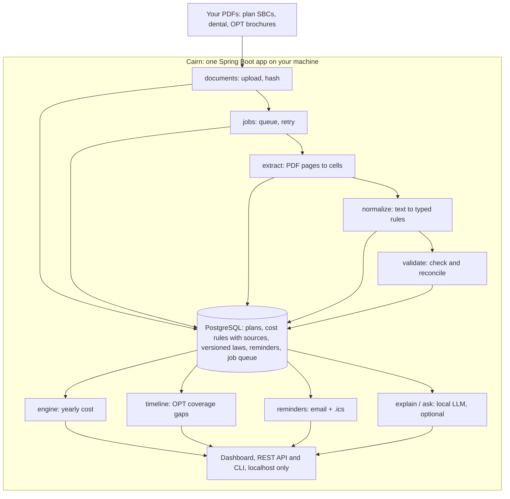
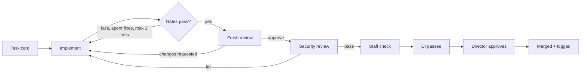

# Cairn: System Architecture & 7-Day Roadmap

Nov 18, 2026 · @Vaishnavi Bhairishetty

## 1. Overview

Cairn is a free, open-source, self-hosted tool that helps employees choose the right health plan, use the benefits they already pay for, and avoid coverage gaps, with extra guidance for F-1 students on OPT and STEM OPT. Version 1 ships in 7 days (Thu Nov 19 to Wed Nov 25, 2026), during open enrollment season.

**The name.** A cairn is a stack of stones hikers build to mark the trail where the path is hard to see. Cairn marks the trail through a health system that is hard to read, especially for someone new to the US. Tagline: *Trail markers for your health coverage.* No health insurance or benefits product using the name was found; the word is used by unrelated companies in other fields.

**The problem, with evidence**

- Employer coverage is the largest group: it covers almost 157 million people under 65 ([KFF](https://www.kff.org/health-costs/issue-brief/2026-employer-health-benefits-survey/)).
- People choose badly: in one study, more than 80% of employees at a Fortune 100 company picked the wrong plan ([Dallas News](https://dallasnews.com/business/health-care/2019/10/30/3-tips-for-choosing-the-right-health-plan-to-match-your-needs)).
- It is expensive: the average yearly cost of choosing the wrong plan was more than $2,000 in a University of Dayton analysis ([US Rx Care](https://usrxcare.com/most-workers-make-bad-health-insurance-decisions/)).
- It is rushed: the average employee spends only 30 to 60 minutes choosing benefits ([US Rx Care](https://usrxcare.com/?p=5463)).

**The extra problems for F-1 students on OPT and STEM OPT**

- The school plan often ends 30 to 60 days after graduation, before the employer plan starts ([GradRight](https://gradright.com/opt-health-insurance-guide-for-international-students-coverage-costs-best-plans/)).
- From January 1, 2027, F-1 holders, including OPT and STEM OPT, cannot get marketplace premium subsidies ([F1Jobs](https://www.f1jobs.io/resources/blog/aca-marketplace-subsidies-end-2027-h1b-f1-opt)); about 1.23 million lawfully present people lose subsidy eligibility in 2027 ([Health Affairs](https://www.healthaffairs.org/do/10.1377/forefront.20260522.447008)).
- Many international student plans are not ACA compliant, with caps of $100,000 to $500,000 and waiting periods for pre-existing conditions ([International Student Insurance](https://www.internationalstudentinsurance.com/blog/?p=4706)).

**The gap.** Good decision tools exist, but they are sold to employers, such as Jellyvision's ALEX ([Fortune](https://dc.fortune.com/2016/01/05/jellyvision-alex-interactive-software-health-plan)). If your employer did not buy one, you get a stack of PDFs. The only open-source alternative found had 3 stars ([open-coverage](https://awesome.ecosyste.ms/projects/github.com%2Faaln%2Fopen-coverage)). Nothing free and private serves the individual employee, and nothing at all serves the OPT transition.

**Origin story (interview line):** *"I'm an F-1 student. I built Cairn because I was about to make this decision myself and could not find a tool that understood my situation."*

## 2. Users and v1 scope

Version 1 serves every employee with an employer plan, and adds a dedicated path for F-1 students moving to OPT and STEM OPT.

| Persona | Situation | What Cairn gives them |
| --- | --- | --- |
| New employee | Has 2 to 4 plans and one week to choose | Expected yearly cost per plan, best and worst case, with every number linked to its source line |
| F-1 student graduating to OPT | School plan ends, job and employer plan start later | A coverage timeline that shows uninsured days and options to close them |
| STEM OPT worker changing jobs | Between employers, inside the unemployment allowance | The same timeline plus rule notices with effective dates |
| Any covered person | Does not know what is free | A personal checklist of no-cost preventive care and reminders |

**Features by priority**

| Priority | Feature | Day |
| --- | --- | --- |
| 1 | Upload plan documents (SBC PDFs), extract and normalize them | 2 to 4 |
| 2 | Compare plans: expected, best and worst yearly cost for your usage | 4 to 5 |
| 3 | Free-benefits checklist and reminders (email and calendar file) | 5 |
| 4 | "What changed since last year?": rule-by-rule comparison of two versions of the same plan | 5 |
| 5 | OPT coverage timeline and versioned rule notices | 6 |
| 6 | Rule Watcher, basic: a weekly GitHub Actions job that detects changes on rule source pages and opens an issue for human review | 7 |
| Stretch | "Ask Cairn": answers plan questions using only your documents, Cairn's results and the official glossary, with sources and refusals (RAG on pgvector) | 6 |
| Stretch | Red-flag scanner for non-standard international or OPT plan brochures | 6 |
| Later | AI summaries in the Rule Watcher; a full 30-question evaluation set for Ask Cairn | Week 2 |
| Later | In-network provider finder through public insurer directory APIs | Weeks 2 to 4 |

**Out of scope for v1:** live appointment booking (no open data source, see section 9), marketplace plan shopping (HealthCare.gov already does it), user accounts in the cloud, mobile apps, and any immigration or insurance advice.

**Done means**

- [ ] The design doc passed an Elephant-Goldfish review and you approved it before coding started
- [ ] A fresh clone runs with `docker compose up` on an M1 Mac using less than 8 GB of RAM
- [ ] SBCs from at least 3 different insurers extract correctly
- [ ] For every test SBC, Cairn's simulation of the document's own coverage examples matches the totals printed in it within $50
- [ ] Every number shown links to its source page and line
- [ ] The OPT timeline flags a gap for a known test case and shows the 2027 subsidy rule with its source
- [ ] Reminders arrive in a local test mailbox and import into a calendar
- [ ] The Rule Watcher opens an issue when a test source page changes
- [ ] Every merge passed Spotless, Error Prone, the Spring Modulith verify test, CodeQL and dependency review, with a `/security-review` result in the pull request
- [ ] Every threat in `docs/threat-model.md` has a passing security test, and no high-severity findings are open
- [ ] CI is green on every merge; v0.1.0 is tagged with a published Docker image
- [ ] `docs/ai-workflow.md` records every agent task, what you rejected, and at least 3 bugs caught in review
- [ ] Three real F-1 classmates have tried it and given feedback

## 3. Why the data is messy

The Summary of Benefits and Coverage (SBC) is federally required to follow one outline, but every insurer prints it differently, and the cost rules inside it are written in free text.

| Problem | Example | How Cairn handles it |
| --- | --- | --- |
| Same outline, different layouts | SBCs are federally mandated, but carrier implementations vary in layout and terminology ([Sensible](https://www.sensible.so/doc-types/summary-of-benefits)) | The locator finds sections by their required questions and headings, not by page position |
| Costs written as sentences | "$30 copay/visit; deductible does not apply", "20% coinsurance after deductible", "No charge", "Not covered" | A small cost-sharing grammar parses each cell into a typed rule (copay, coinsurance, free, not covered, before or after deductible) |
| Two or three network columns | In-network, out-of-network, and sometimes a preferred tier | Each column becomes a separate rule tagged with its network |
| Individual and family amounts in one cell | "$1,500 individual / $3,000 family" | Split into separate limits per coverage tier |
| Tables split across pages | The services table usually runs over 4 to 6 pages | Rows are stitched by matching the repeated header |
| Footnotes that change meaning | "Limited to 20 visits per year", "Preauthorization required" | Kept as limitation notes on the rule and shown to the user |
| Dental and vision are separate | Dental plans have no federal summary format | Free-text extraction with confidence scores; low-confidence values are confirmed by the user |
| International and OPT plan brochures | Often not ACA compliant, with policy maximums and pre-existing waiting periods ([International Student Insurance](https://www.internationalstudentinsurance.com/blog/?p=4706)) | The red-flag scanner looks for these specific terms and warns (stretch goal) |
| Rules change over time | The F-1 marketplace subsidy rule changes on Jan 1, 2027 | Rules are stored as data with effective dates and sources, never hard-coded |
| Users guess their usage | "Maybe 3 doctor visits?" | Cairn shows low, expected and high scenarios instead of one false-precise number |

**Built-in answer key.** Every SBC must include coverage examples: worked totals for scenarios such as having a baby or managing Type 2 diabetes ([BrightFire](https://clients.brightfire.com/article/how-to-read-summary-benefits-coverage/)). Cairn runs those same scenarios through its own engine and compares the result with the totals printed in the document. If they disagree, either the extraction or the engine is wrong, and the plan is flagged.

**Rule of the system:** a value that fails validation is never used silently. It is quarantined with its reason, or shown to the user to confirm.

## 4. Architecture

Cairn is a modular monolith that runs entirely on the user's own machine: one Spring Boot app, one Postgres database, and clear internal modules. Uploaded documents are processed by a background worker, and every number the user sees comes from a validated, source-linked record.


Values that fail validation go to quarantine or the review screen, never into estimates. Nothing leaves your machine; the optional LLM only rewords numbers the engine produced.

The pipeline turns each PDF into validated, source-linked rules once; the engine, timeline and reminders only ever read those verified rules.

| Module (Java package) | Job | Key technique you will learn |
| --- | --- | --- |
| `documents` | Upload, store and fingerprint PDFs | Multipart upload, SHA-256 dedupe, file storage behind an interface |
| `jobs` | Runs extraction in the background | Postgres queue with `FOR UPDATE SKIP LOCKED`, retries with backoff, job status the UI can poll |
| `extract` | Finds SBC sections and pulls table cells | PDFBox text extraction, Tabula table detection, header stitching across pages |
| `normalize` | Turns cell text into typed rules | A small parser for cost-sharing phrases, money parsing, network and tier splitting |
| `validate` | Checks plans before use | Sanity checks (out-of-pocket max at least the deductible), coverage-example reconciliation, quarantine |
| `engine` | Estimates yearly cost per plan and scenario | Pure, deterministic Java with `BigDecimal`; the most tested module |
| `diff` | "What changed since last year?" | Matching rules across two plan versions by service and network, then classifying each change |
| `rules` | Versioned facts with effective dates and sources | Rules as data (YAML loaded into Postgres), "as of date" queries |
| `timeline` | OPT coverage-gap checker | Date-range arithmetic with `java.time`, overlap and gap detection |
| `reminders` | Free-benefit reminders | Spring `@Scheduled` jobs, email over SMTP, `.ics` calendar export with iCal4j |
| `ask` (stretch) | Answers plan questions with sources | RAG: chunking, embeddings in pgvector, retrieval, a local LLM, guardrails that block numbers not found in the sources, and refusals |
| `api`, `web`, `cli` | REST API, dashboard, command line | Spring MVC + OpenAPI, Thymeleaf + Chart.js, picocli |
| Rule Watcher (outside the app) | Weekly check of rule source pages | A scheduled GitHub Actions workflow that hashes and diffs public pages and opens an issue; humans approve every rule change |

**Tech stack and the reason for each choice**

| Choice | Why |
| --- | --- |
| Java 21 + Spring Boot 3 + Maven | Builds on the Java you know; Maven matches your tutorial |
| Spring Modulith | Turns the modular monolith into a rule the build checks: no reaching into other modules' internals, no cycles |
| PostgreSQL 16 + Flyway + pgvector | One store for data, provenance, rules, the job queue and the embeddings for Ask Cairn; a schema per module; versioned migrations |
| Redis | Caches computed comparisons and rule lookups; the tutorial does not cover caching |
| Apache PDFBox 3 + Tabula-java | Mature Java PDF libraries |
| Thymeleaf + Chart.js + Spring Security (CSRF) | A usable, safe UI in a day, without learning React this week |
| Mailpit (local test mail server) | Reminders can be tested without sending real email |
| JUnit 5, AssertJ, Mockito, jqwik, Testcontainers | The full test pyramid with a real Postgres, plus property-based tests for the engine |
| Spotless (Google Java Style) + Error Prone | Consistent formatting and compile-time bug detection on every build |
| CodeQL, Dependabot, secret scanning, Trivy | Free automated security checks on every pull request and image |
| GitHub Actions + GHCR | CI on every pull request, the weekly Rule Watcher, and a Docker image on each release tag |
| Docker Compose on Colima | One command to run everything, lighter than Docker Desktop on 8 GB |
| Ollama: a small chat model (1B to 3B) and a small embedding model, off by default | Free, local and private; runs natively on the M1 |
| Claude Code + the Elephant-Goldfish Model plugin + `/security-review` | Design drafting and fresh-context reviews before code, bounded coding tasks you review, and an AI security pass on every change (sections 10 and 11) |

**Memory budget (approximate):** Postgres with pgvector 0.3 GB, Redis 0.05 GB, Mailpit 0.05 GB, app 0.5 to 1 GB, Ollama with a 3B chat model and a small embedding model about 3 GB (optional). Under 5 GB with everything on.

## 5. Data model

The database keeps raw extractions separate from the typed plan rules built from them, so every rule can be traced back to the exact text in the PDF, and a parser fix can be applied by re-running extraction.

| Table | Key columns | Why it exists |
| --- | --- | --- |
| `profile` | `age_band`, `coverage_tier` (self, self + spouse, family), `visa_status` (optional) | The minimum personal data needed; no name, no SSN, no medical history |
| `document` | `kind` (sbc, dental, vision, brochure), `sha256`, `bytes`, `uploaded_at`, `status` | One row per uploaded file |
| `job` | `type`, `document_id`, `status`, `attempts`, `next_run_at`, `last_error`, `locked_at` | The background queue |
| `raw_cell` | `document_id`, `page`, `section`, `row_idx`, `col_idx`, `raw_text`, `bbox` | Exactly what the PDF said, and where |
| `plan` | `name`, `insurer`, `plan_type` (HMO, PPO, EPO, HDHP), `premium_per_paycheck`, `paychecks_per_year`, `employer_hsa_contribution` | Premiums come from the employer's rate sheet, typed by the user |
| `plan_limit` | `plan_id`, `kind` (deductible, oop\_max), `tier`, `network`, `amount`, `source_cell_id` | Deductibles and out-of-pocket maximums |
| `cost_rule` | `plan_id`, `service` (primary\_care, specialist, er, generic\_rx, ...), `network`, `type` (copay, coinsurance, free, not\_covered), `amount`, `applies_after_deductible`, `limits_note`, `source_cell_id`, `confidence` | One typed rule per service and network |
| `price_assumption` | `service`, `typical_price`, `source`, `editable` | Typical pre-insurance prices, clearly labeled as estimates the user can change |
| `estimate` | `plan_id`, `scenario` (low, expected, high, worst), `total`, `breakdown` (jsonb), `computed_at` | Cached results of the engine |
| `rule` | `code`, `applies_to` (e.g. F-1), `statement`, `effective_from`, `effective_to`, `source_url`, `verified_on` | Versioned legal and policy facts |
| `timeline_event` | `profile_id`, `kind` (graduation, ship\_end, opt\_start, job\_start, plan\_start), `date` | Inputs to the OPT gap checker |
| `reminder` | `profile_id`, `benefit`, `due_on`, `channel` (email, ics), `sent_at` | Scheduled free-benefit reminders |
| `quarantine` | `document_id`, `page`, `reason`, `raw`, `created_at` | Values that failed validation |

**Rules the schema enforces**

- Money is `NUMERIC` in the database and `BigDecimal` in Java, never `double`.
- Every `cost_rule` and `plan_limit` points to a `raw_cell`, which is the provenance chain shown in the UI.
- A `rule` is never edited in place when the law changes: a new row with a new `effective_from` is added, so Cairn can answer "what applied on this date?"
- Rules carry a `verified_on` date. The UI shows it, and rules not re-verified within 90 days are marked as needing review.

## 6. Cost engine and how we prove it is correct

The engine is a pure function: plan rules plus a usage scenario in, a yearly cost with a line-by-line breakdown out. It does no I/O, which makes it fast and easy to test exhaustively.

```latex
\text{Yearly cost} = \text{premium per paycheck} \times \text{paychecks} + \min\left(\sum_{\text{events}} \text{your share},\ \text{out-of-pocket max}\right) - \text{employer HSA contribution}
```

**How "your share" of each medical event is computed**

1. In-network preventive care: $0.
2. A copay that applies before the deductible: the copay.
3. Otherwise, while the deductible is not yet met: you pay the price until it is met.
4. After the deductible: the copay, or the coinsurance percentage times the price.
5. A running total stops growing once it reaches the out-of-pocket maximum.
6. "Not covered" services count in full and do not count toward the maximum.

**Scenarios shown for every plan:** low use, expected use (from the user's answers), high use, and worst case (premiums plus the in-network out-of-pocket maximum). Out-of-network care can have no maximum, and Cairn says so plainly.

**Known simplifications in v1, shown in the UI:** family embedded deductibles, drug formulary tiers beyond generic and brand, and network-specific prices are approximated. Typical service prices are labeled estimates the user can edit.

**How we prove it is correct**

| Check | What it proves | Tool |
| --- | --- | --- |
| Unit tests per rule type | Each of the 6 steps above behaves exactly as written | JUnit 5 + AssertJ |
| Property-based tests | Invariants hold for thousands of random plans: cost never exceeds premiums plus the maximum, more usage never costs less, preventive care is always $0 in-network | jqwik |
| Coverage-example reconciliation | Running the SBC's own example scenarios reproduces the totals the insurer printed, within $50 | Golden-file tests on real SBCs |
| Hand-calculated cases | Three plans worked out on paper by you, committed as expected results | JUnit 5 |

The reconciliation check is the strongest interview point: the insurer's own document is the answer key, so accuracy is measured, not claimed.

## 7. API, CLI and UI

The REST API is versioned under `/api/v1` and only listens on `localhost` by default, because it handles personal health-plan data. The dashboard and CLI call the same services.

| Method and path | Purpose |
| --- | --- |
| `POST /api/v1/documents` | Upload a PDF; returns a job id (`202 Accepted`) |
| `GET /api/v1/jobs/{id}` | Extraction status: queued, running, needs\_review, done, failed |
| `GET /api/v1/plans` / `GET /api/v1/plans/{id}` | Normalized plans with their rules |
| `PATCH /api/v1/plans/{id}/rules/{ruleId}` | User confirms or corrects a low-confidence value |
| `POST /api/v1/comparisons` | Body: plan ids + usage answers; returns estimates per scenario with breakdowns |
| `GET /api/v1/rules/{id}/source` | The page, raw text and PDF link behind a value |
| `GET /api/v1/benefits/free` | The personal free-benefits checklist |
| `POST /api/v1/reminders` / `GET /api/v1/reminders.ics` | Create reminders; download them as a calendar file |
| `POST /api/v1/timeline/check` | Body: OPT dates; returns gaps and the rules that apply on those dates |
| `GET /actuator/health`, `/actuator/prometheus` | Health and metrics |

Errors use the RFC 9457 problem-details format. OpenAPI docs are served at `/swagger-ui`.

**CLI**

```
cairn extract plan-a.pdf --out plan-a.json   # parse one SBC
cairn compare plan-a.pdf plan-b.pdf --visits 4 --specialist 1 --rx generic
cairn timeline --grad 2027-05-15 --ship-end 2027-06-30 --job-start 2027-08-01 --plan-start 2027-09-01
```

**Dashboard pages**

1. **Compare:** a cost range bar per plan (low to worst case) with the expected value marked, and a plain-English recommendation with its reasons.
2. **Plan detail:** every rule in plain language; click any number to see the PDF line it came from.
3. **Free benefits:** a checklist of no-cost preventive care for your age and coverage, plus dental cleanings if your dental plan covers them, each with a "remind me" button.
4. **OPT timeline:** a horizontal timeline from graduation to employer coverage, with uninsured days shaded and the rules that apply listed with their sources.
5. **Review:** values Cairn was not confident about, for the user to confirm.

## 8. Privacy, reliability, testing, CI/CD, observability and Git

Privacy is the first design constraint: nothing leaves the user's machine, and Cairn stores the least data it can.

**Privacy by design**

- Self-hosted only; the server binds to `localhost` by default.
- No third-party calls in v1. The optional LLM runs locally.
- Data minimization: an age band instead of a birth date, no names, no member IDs, no medical history.
- Logs never contain document text or personal values; a test fails if they do.
- A "delete everything" button and CLI command wipe documents and data.

**Reliability**

- Extraction jobs are idempotent: re-uploading the same file (same SHA-256) reuses the result.
- Failed jobs retry with exponential backoff, at most 3 times, then show their error in the UI.
- Reminders are sent at most once, by recording `sent_at` in the same transaction as the send attempt.
- Rule data is validated at startup: a missing source URL or an overlapping effective-date range stops the app with a clear error.

**Testing strategy**

| Level | What it covers | Tools | Rough count by Day 7 |
| --- | --- | --- | --- |
| Unit | Cost-sharing parser, money parsing, engine steps, timeline gap math, rule lookup by date | JUnit 5, AssertJ, Mockito | 70+ |
| Property-based | Engine invariants across random plans | jqwik | 5 properties |
| Golden file | Real SBCs from 3+ insurers, with expected JSON and coverage-example totals | JUnit 5 + fixtures | 3 to 5 |
| Integration | Repositories, job queue, Flyway migrations, scheduler | Testcontainers | 10+ |
| API | Endpoints, status codes, problem details, upload limits | Spring MockMvc | 10+ |
| End to end | `docker compose up`, upload a fixture SBC, compare, receive a reminder in Mailpit | GitHub Actions + script | 1 smoke test |

Coverage target: 80% for `engine`, `normalize` and `timeline`; 70% overall (JaCoCo).

**CI/CD with GitHub Actions:** on every pull request, build, check formatting (Spotless) and run all tests; on merge to `main`, also run the end-to-end smoke test; on a `v*` tag, build and push the Docker image to GHCR and create a release. Dependabot keeps dependencies current.

**Observability:** structured JSON logs with `jobId` and `documentId` (never personal data); Micrometer metrics such as `cairn_jobs_total{status}`, `cairn_extraction_confidence`, `cairn_quarantine_total{reason}` and `cairn_reminders_sent_total`; Actuator health checks used by Docker Compose.

**Git workflow:** protected `main`; one branch per task (`feat/sbc-parser`, `test/engine-properties`); Conventional Commits; squash merges; semantic version tags. Commits carry only your name, with no AI co-author lines or other credits.

## 9. Key tradeoffs (decision records)

Each decision becomes a short ADR file in `docs/adr/`. These are your answers to "why did you choose X?"

| # | Decision | Chosen | Rejected alternative | Why |
| --- | --- | --- | --- | --- |
| 1 | Where it runs | Self-hosted, localhost only | A hosted web app with accounts | Health-plan data is sensitive; keeping it on the user's machine removes most privacy and security risk for a v1 |
| 2 | Service shape | Modular monolith | Microservices (as in your tutorial) | One developer, one database, one main workflow; module boundaries keep a later split possible |
| 3 | Background work | Postgres queue with `SKIP LOCKED` | Kafka or RabbitMQ | A handful of uploads per user; one less service; jobs and data commit together |
| 4 | Role of the LLM | Explains numbers it is given; never calculates | LLM reads plans and computes costs | Money must be deterministic and testable; LLM text is checked against engine output |
| 5 | Legal and policy facts | Versioned rules as data with effective dates and sources | Hard-coded `if` statements | The F-1 subsidy rule changes on Jan 1, 2027; data can be updated and audited without code changes |
| 6 | Uncertain usage | Show low, expected, high and worst-case scenarios | One "best plan" number | Users guess their usage; a range is honest and still decision-ready |
| 7 | Appointment availability | Not in v1; show phone and booking links later | Scrape hospital portals | No open data source; Zocdoc's API needs a developer account and access token ([Zocdoc](https://api-docs.zocdoc.com/guides/patient/book-appointments)); scraping breaks terms of use |
| 8 | Provider directory | Deferred to weeks 2 to 4 | Build it in week 1 | Coverage across insurers varies and directory data is often inconsistent ([1upHealth](https://1up.health/?p=23035)); the core decision tool comes first |
| 9 | UI | Server-rendered Thymeleaf + Chart.js | React single-page app | A working UI in a day; the value is in the data and the engine |
| 10 | Money type | `NUMERIC` / `BigDecimal` | `double` | Floating point cannot represent most decimal amounts exactly |

## 10. Development workflow: AI-directed, human-verified

You are the director: you set direction, approve the design and approve every merge. Claude acts as the staff engineer: it designs, breaks the work into tasks, delegates each task to a coding agent sized to its difficulty, and makes sure every result passes the gates in section 11 and an independent check. No agent trusts another agent's claim, Claude's or yours, without evidence such as test output or CI logs.

**Design first, with the Elephant-Goldfish Model (EGM).** EGM is an open-source framework Google uses internally ([Google Open Source Blog](https://opensource.googleblog.com/2026/10/introducing-elephant-goldfish-model-plugin.html)). The *Elephant* is a long-running design session that holds the project memory and writes no code. *Goldfish* are fresh agents with no shared context that review the design for gaps. You approve the design before any code is written. It installs in Claude Code with `claude plugin marketplace add google/elephant-goldfish-model` and `claude plugin install egm@egm` ([GitHub](https://github.com/google/elephant-goldfish-model)).

| Step | How | Who |
| --- | --- | --- |
| 1. Brainstorm | Done in our planning conversation | You and Claude |
| 2. Draft | The EGM draft protocol, using this document as input; output in `docs/designs/cairn.md` | Claude (the Elephant) |
| 3. Goldfish review | The EGM review protocol: comprehension check, adversarial review, implementation-readiness check, each run by fresh agents with no shared context | Fresh review agents; you approve the result |
| 4. Build | The task loop below, one task at a time | Coding agents, orchestrated by Claude |
| 5. Approve | You read each pull request summary and merge it | You |
| 6. Walkthrough | Each evening Claude walks you through what was built and why; you explain key parts back; sometimes Claude plants a bug for you to spot by reading | You and Claude |
| 7. Evidence | `docs/ai-workflow.md`: each task, the agent that built it, review findings, what was rejected, bugs caught | Claude, reviewed by you |

**Agent roles**

| Role | Model tier | Gets tasks like |
| --- | --- | --- |
| Staff engineer and orchestrator | Claude (this session) | Design, task cards, delegation, final verification, pull request summaries, daily walkthrough |
| Senior implementer (SDE2) | Most capable model | Cost engine, cost-sharing parser, OPT timeline, validation and reconciliation, anything security-sensitive |
| Implementer (SDE1) | Mid-tier model | REST endpoints, job queue, reminders, Thymeleaf pages, CLI |
| Junior implementer | Fast, low-cost model | Boilerplate, configuration, Dockerfile, CI YAML, README sections |
| Independent reviewer | Fresh agent, never the author | Re-derives expected behavior from the task card, tries to break the code, checks hand-calculated cases |
| Security reviewer | Fresh agent | Reviews every change against `docs/threat-model.md` and runs a security review of the diff |

**The task loop (every task, no exceptions)**

1. **Task card:** Claude writes the goal, acceptance criteria, files and interfaces, required tests, and the gates to pass.
2. **Implement:** the assigned agent writes tests first, then code, on a feature branch.
3. **Self-check:** build, tests, Spotless, Error Prone, Spring Modulith verify and coverage, run on your Mac.
4. **Fix loop:** the agent fixes failures until everything is green; after 3 failed attempts the task is escalated to Claude.
5. **Independent review:** a fresh reviewer checks the code against the task card, not against the author's claims.
6. **Security review:** a fresh security agent checks the diff against the threat model.
7. **Staff check:** Claude re-runs the tests itself and spot-checks the logic; nothing is accepted on an agent's word.
8. **CI:** the branch is pushed and GitHub Actions must pass.
9. **Your approval:** you read the pull request summary and merge.
10. **Log:** the task, its agents, findings and rejections go in `docs/ai-workflow.md`.


After 3 failed tries, or any product question, the task is escalated: first to the orchestrator, then to the director.

Work only moves forward with evidence; a failed gate or a reviewer's change request sends it back to the implementing agent.

**Escalation:** product decisions, unclear requirements and anything that changes scope come to you before work continues.

**Repo files that hold the project memory (the Elephant's notebook):** `docs/designs/cairn.md`, `docs/adr/`, `TASKS.md`, `CLAUDE.md` (project rules for agents: no AI credit lines in commits, no emoji in code, simple comments), and `docs/ai-workflow.md`.

**Not covered by this project:** the algorithm round without AI that new-grad candidates still face. Practice it separately for 30 minutes each evening (section 12).

**Interview line:** *"I directed Cairn like an engineering lead. The design passed an Elephant-Goldfish review before any code existed. Every task went through a loop of implementation, automated gates, an independent reviewer and a security reviewer, and I approved every merge. Here's a bug the reviewer caught that the author agent missed."*

## 11. Quality and security gates

Every standard in this project is enforced by a tool, not by memory: a change that breaks a rule fails the build, whether you or an agent wrote it.

**Coding standards and architecture**

| Rule | Enforced by | When |
| --- | --- | --- |
| One consistent style | Google Java Style, auto-formatted by Spotless; unformatted code fails the build | Every build and pull request |
| Common bugs caught at compile time | Error Prone, Google's compile-time bug checker | Every build |
| Module boundaries respected, no cycles | Spring Modulith `ApplicationModules.verify()` in a test ([Spring docs](https://docs.spring.io/spring-modulith/reference/1.4.8/verification.html)) | Every build |
| Architecture diagrams match the code | Spring Modulith's documenter generates them from the code | Every release |
| Every architectural decision justified | An ADR in `docs/adr/` | Every design change |
| Agents follow the same rules | `CLAUDE.md` lists these standards; agent code passes the same gates | Every agent task |

**Modular, reusable code and data**

- Each module exposes a small public API; its internals live in an `internal` package that other modules cannot use.
- Each module owns its tables in its own Postgres schema with its own migrations; other modules read that data only through the owning module's API.
- Normalized plans follow a versioned JSON Schema, the "Cairn plan format", so tests, other tools and future features can reuse the data.
- Legal rules live in a separate YAML data pack that can be reused without the app.
- Reuse rule: extract shared code once it is needed in three real places, not before.

**Security on every change**

| Layer | Tool | Cost |
| --- | --- | --- |
| AI review before each pull request | Claude Code `/security-review` on the pending changes ([Claude Help Center](https://support.claude.com/en/articles/11932705)); findings and your decisions go in the pull request description | Included with a paid Claude plan |
| Static analysis | GitHub CodeQL code scanning | Free for public repos |
| Vulnerable dependencies | Dependabot alerts and dependency review on pull requests | Free |
| Leaked secrets | GitHub secret scanning with push protection | Free for public repos |
| Container image | Trivy scan of the Docker image in CI | Free |
| Human validation | You confirm or dismiss every finding; AI results are never auto-applied | Your time |
| Later | Anthropic's security-review GitHub Action; it needs a paid API key and is meant only for trusted pull requests ([GitHub](https://github.com/anthropics/claude-code-security-review)) | Paid, not in v1 |

**Threat model: the risks specific to Cairn** (kept in `docs/threat-model.md`, each threat with a security test)

| Threat | Defense | Test |
| --- | --- | --- |
| Malicious or huge PDF upload | Size limit (10 MB), page limit, parser timeout, PDF-only content check | Upload an oversized file and a fake PDF; both are rejected |
| Prompt injection inside a PDF ("ignore your instructions") | Ask Cairn treats document text as data, never instructions; answers must cite sources; numbers must match engine output | A fixture SBC with injected text; the answer ignores it |
| Rule Watcher fetching unsafe URLs | Fetches only from an allowlist of official domains | A non-allowlisted URL is refused |
| Cross-site scripting | Thymeleaf auto-escaping; no unescaped user text | A plan name containing a script tag renders as text |
| SQL injection | Parameterized queries only | A malicious search string returns no extra rows |
| Cross-site request forgery | Spring Security CSRF tokens on all forms | A form post without a token is rejected |
| Exposure on the network | Server binds to `localhost` by default | A startup test checks the bind address |
| Personal data in logs | Log scrubbing and no document text in logs | A test fails if a known personal value appears in log output |

**Interview line:** *"Every change passed automated style, architecture and security checks, plus an AI security review that I validated by hand. Here's a prompt-injection risk I found in my own RAG feature and the test that guards it."*

## 12. 7-day roadmap

The plan is about 8 focused hours a day: 6 on Cairn and 2 on the tutorial. The pipeline is built in order (upload, extract, normalize, compute, show), so something works end to end each day.

**Daily rhythm**

| Time | Block |
| --- | --- |
| 9:00 to 9:30 | Director standup: Claude presents the day's task cards and agent assignments; you approve or change them |
| 9:30 to 4:00 | Agents build through the task loop; you approve pull requests as they arrive (about 15 minutes each) and answer escalations |
| 4:30 to 6:30 | Tutorial (sections per day below) |
| 7:30 to 8:30 | Daily walkthrough: what was built and why, you explain key parts back, and sometimes a planted-bug drill |
| 8:30 to 9:00 | Algorithm practice without AI (recommended for the new-grad interview round) |

**Tonight (Wed Nov 18, about 1 hour):** on your Mac, install Homebrew, JDK 21 (Temurin), Maven, Colima and the Docker CLI, and Git; sign in to GitHub; create an empty `cairn` folder and connect it in the Claude desktop app (+ menu, then Add folder) so agents can build and test there. Collect 3 to 5 real SBC PDFs from different insurers, starting with your own student plan's SBC. IntelliJ IDEA Community is optional, for reading code during walkthroughs.

| Day | Theme | Agents build (through the task loop) | Tutorial (4:30 pm) | Done when |
| --- | --- | --- | --- | --- |
| 1 Thu Nov 19 | Design, gates and foundations | Morning: EGM draft and Goldfish review of the design, `docs/threat-model.md`, `CLAUDE.md`; you approve `docs/designs/cairn.md`. Afternoon: repo, Spring Boot skeleton, `docker-compose.yml` (Postgres with pgvector, Redis, Mailpit), first Flyway migration, CI with Spotless, Error Prone, the Spring Modulith verify test, CodeQL, Dependabot and secret scanning. A golden JSON file for one SBC, checked by hand by Claude. You message 3 F-1 classmates. | 00:00 to 01:42 | Design approved with review findings logged; pull request #1 merged by you with all gates green |
| 2 Fri Nov 20 | Upload and jobs | Upload endpoint with size, page and type limits, file storage, SHA-256 dedupe, `job` queue and worker with `SKIP LOCKED`, retries, status endpoint, JSON logs with scrubbing, Trivy scan | 01:42 to 03:28 | Same file twice creates one document; a failing job retries then shows its error; oversized and fake PDFs are rejected by tests |
| 3 Sat Nov 21 | Extract | SBC section locator, Tabula table extraction, page stitching, `raw_cell`, golden tests for 3 insurers | 08:45 to 09:23 (testing) | The services table of all test SBCs lands in `raw_cell`; golden tests pass |
| 4 Sun Nov 22 | Normalize and engine | Senior implementer: cost-sharing parser, limits, validators, quarantine, engine steps 1 to 6, property-based tests; independent reviewer works the 3 hand-calculated plans | Optional: 03:28 to 04:43 | Every test SBC becomes typed rules; 40+ unit tests and 5 properties pass |
| 5 Mon Nov 23 | Compare, benefits and diff | Scenarios, coverage-example reconciliation, comparisons API, Redis cache, free-benefits checklist, reminders (scheduler, Mailpit, `.ics`), plan-version diff | Optional: 04:43 to 06:02 | Reconciliation within $50 for every test SBC; a reminder arrives in Mailpit; the diff of two plan years is correct |
| 6 Tue Nov 24 | OPT and UI | Senior implementer: rules YAML and timeline gap checker. Implementers: dashboard pages with CSRF and escaping tests, picocli CLI, metrics. Stretch: Ask Cairn with a 10-question evaluation including a prompt-injection case, red-flag scanner | Optional: 06:02 to 08:45 | A test OPT timeline shows its gap days and the 2027 rule; the full demo works in the browser; XSS and CSRF tests pass |
| 7 Wed Nov 25 | Ship | Rule Watcher (basic, allowlisted URLs), end-to-end CI test, Docker image to GHCR on tag, README with demo GIF, ADRs, privacy notes, threat model and disclaimer, finished `docs/ai-workflow.md`, v0.1.0 release; you collect classmates' feedback and rehearse the 2-minute pitch | Rest | A fresh clone runs with `docker compose up`; no open high-severity findings; 3 classmates have tried it |

The tutorial's AWS chapter (09:23 onward) waits until after this week; Cairn deliberately runs locally.

## 13. Risks, limitations, cut list, how we work, disclaimer and sources

The biggest risk is extraction quality across insurers on Day 3; the plan protects the deadline by cutting features in a fixed order, never cutting correctness.

| Risk | Likelihood | Fallback |
| --- | --- | --- |
| An insurer's SBC layout defeats the table extractor | High | Per-insurer extraction settings; a review screen where the user confirms values; drop to 2 insurers if needed |
| Reconciliation does not match within $50 | Medium | Investigate per scenario; document known simplifications; never hide the mismatch |
| Rules go out of date | Medium | `verified_on` dates, a 90-day review flag, and sources shown next to every rule |
| Memory pressure on 8 GB | Medium | Colima VM capped at 4 GB; LLM off by default |
| Falling behind | Medium | Use the cut list below the evening it happens |

**Known limitations (shown in the README)**

| Limitation | Why | What we do about it |
| --- | --- | --- |
| Costs are estimates, not bills | Real prices vary by provider and region; no claims data | Ranges and editable price assumptions, clearly labeled |
| No automatic plan updates | Cairn only knows the documents you upload | Mid-year changes come with 60 days' notice, often as an updated SBC ([Cigna](https://www-cigna-com.extwideip.cigna.com/employers/insights/informed-on-reform/summary-of-benefits-and-coverage)); upload it and use "What changed?" |
| No catalog of every insurer's plans | Employer plans are customized per employer | Document-driven: any plan with an SBC works; plans are grouped by insurer and type from the SBC header |
| Accuracy depends on the PDF | Scanned or unusual layouts can fail | Review screen for low-confidence values; OCR is not in v1 |
| No live network or appointment data | No open, reliable source | Provider finder later; no booking |
| Simplified details | Family embedded deductibles and detailed drug tiers | Listed in the UI |
| Legal rules need upkeep | Laws change | Rule Watcher, versioned rules, `verified_on` dates, human approval |
| Small local AI model | 8 GB of RAM limits model size | Answers grounded in sources, shown with citations, refusals when unsure |
| Self-hosting needs Docker | Hard for non-technical users | Later: a hosted demo with sample data only, or a one-click desktop download |
| Not advice | Insurance, legal and immigration decisions | Disclaimer in the app and README |

**Cut list, first to go:** (1) Ask Cairn, (2) red-flag scanner, (3) dental and vision parsing (keep manual entry), (4) Rule Watcher (keep `verified_on` review flags), (5) the CLI's `timeline` command, (6) Redis cache.

**Never cut:** tests, CI, provenance links, the review screen, privacy rules, the quality and security gates, and the disclaimer.

**How we work together**

1. **You direct:** you approve the design, each day's task plan and every pull request, and you make all product decisions.
2. **Claude orchestrates:** it writes task cards, assigns each task to an agent sized to its difficulty, enforces the gates and the task loop (section 10), and verifies results itself before anything reaches you.
3. **Agents build and review:** coding agents implement with tests; fresh reviewer and security agents check their work without trusting the author.
4. **Code runs on your Mac and in CI:** builds and tests run in your connected `cairn` folder; GitHub Actions is the final gate on the public repo.
5. **You stay interview-ready:** the evening walkthrough covers every piece built that day, in plain language, including why each decision was made and what was rejected.
6. **Commits:** carry only your name, with no AI credit lines; `docs/ai-workflow.md` records how each task was built.

**Disclaimer shown in the app and README:** Cairn provides estimates and general information. It is not insurance, financial, legal or immigration advice. Confirm coverage with your insurer and immigration questions with your school's international student office.

## Sources

- [KFF, 2026 Employer Health Benefits Survey](https://www.kff.org/health-costs/issue-brief/2026-employer-health-benefits-survey/)
- [Dallas News, 3 tips for choosing the right health plan](https://dallasnews.com/business/health-care/2019/10/30/3-tips-for-choosing-the-right-health-plan-to-match-your-needs)
- [US Rx Care, Most workers make bad health insurance decisions](https://usrxcare.com/most-workers-make-bad-health-insurance-decisions/)
- [US Rx Care, More than half of workers regret open enrollment decisions](https://usrxcare.com/?p=5463)
- [Fortune, Jellyvision ALEX](https://dc.fortune.com/2016/01/05/jellyvision-alex-interactive-software-health-plan)
- [open-coverage on ecosyste.ms](https://awesome.ecosyste.ms/projects/github.com%2Faaln%2Fopen-coverage)
- [GradRight, OPT health insurance guide](https://gradright.com/opt-health-insurance-guide-for-international-students-coverage-costs-best-plans/)
- [F1Jobs, ACA subsidies end for H-1B, H-4 and F-1 in 2027](https://www.f1jobs.io/resources/blog/aca-marketplace-subsidies-end-2027-h1b-f1-opt)
- [F1Jobs, Health insurance on OPT after graduation](https://www.f1jobs.io/resources/blog/health-insurance-on-opt-after-graduation)
- [Health Affairs, Marketplace changes for lawfully present immigrants](https://www.healthaffairs.org/do/10.1377/forefront.20260522.447008)
- [International Student Insurance, ACA vs non-ACA plans](https://www.internationalstudentinsurance.com/blog/?p=4706)
- [NFP, Supreme Court upholds ACA preventive care requirements](https://www.nfp.com/insights/us-supreme-court-upholds-aca-preventive-care-requirements/)
- [Sensible, Summary of Benefits extraction](https://www.sensible.so/doc-types/summary-of-benefits)
- [BrightFire, How to read a Summary of Benefits and Coverage](https://clients.brightfire.com/article/how-to-read-summary-benefits-coverage/)
- [Cigna, Summary of Benefits and Coverage (60-day notice)](https://www-cigna-com.extwideip.cigna.com/employers/insights/informed-on-reform/summary-of-benefits-and-coverage)
- [Capital Blue Cross, Provider directory API access guide](https://my.capbluecross.com/wps/portal/cap/about/developer/provider-directory-api-access-guide)
- [1upHealth, Provider directory data quality](https://1up.health/?p=23035)
- [Zocdoc for Developers, Find availability and book appointments](https://api-docs.zocdoc.com/guides/patient/book-appointments)
- [Google Open Source Blog, Introducing the Elephant-Goldfish Model plugin](https://opensource.googleblog.com/2026/10/introducing-elephant-goldfish-model-plugin.html)
- [GitHub, google/elephant-goldfish-model](https://github.com/google/elephant-goldfish-model)
- [Entrepreneur, Google is testing AI-assisted interviews](https://www.entrepreneur.com/business-news/google-is-testing-a-new-rule-transform-job-interviews)
- [Northeastern Careers, Google's AI-assisted coding interview guide](https://careers.northeastern.edu/blog/2026/05/13/googles-ai-assisted-coding-interview-2026-guide/)
