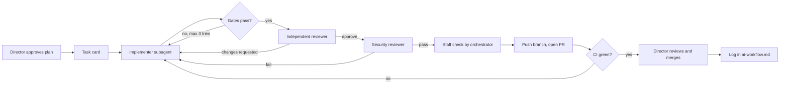

# Cairn agent orchestration

This folder explains how Cairn is built by a team of Claude Code agents directed by a human.
It is the operating manual for the director and the map for anyone reading the repository.

## The idea in one paragraph

The director (a human) decides what to build and approves every merge. The main Claude Code
session acts as a staff engineer: it writes task cards, delegates each task to an implementer
subagent sized to the task, and runs every result through automated gates, an independent
reviewer, a security reviewer, and its own staff check before a pull request reaches the
director. No agent trusts another agent's claims; everything is proven with command output.
Deterministic hooks enforce the rules that must never be broken, so safety does not depend
on an agent remembering an instruction.

## How a task flows



## The files and what each one does

| Path | Kind | Loaded when | Purpose |
| --- | --- | --- | --- |
| `CLAUDE.md` | Project memory | Every session | Roles, non-negotiable rules, commands, layout, escalation |
| `.claude/rules/architecture.md` | Rule | Every session | Modules, allowed dependencies, data ownership, ADRs |
| `.claude/rules/java-coding.md` | Rule (path-scoped) | When a `.java` file is read or edited | Java style beyond the formatter |
| `.claude/rules/testing.md` | Rule | Every session | Test-first, pyramid, required tests, fixtures, coverage |
| `.claude/rules/security.md` | Rule | Every session | Trust boundaries, injection, web, secrets, reviews |
| `.claude/rules/data-and-privacy.md` | Rule | Every session | Minimization, where data may go, deletion |
| `.claude/rules/git-and-delivery.md` | Rule | Every session | Branches, commits, pull requests, CI, releases |
| `.claude/rules/ai-features.md` | Rule (path-scoped) | When AI feature files are touched | RAG and Rule Watcher guardrails |
| `.claude/agents/sde2-implementer.md` | Subagent (Opus) | When delegated | Complex and high-risk tasks |
| `.claude/agents/sde1-implementer.md` | Subagent (Sonnet) | When delegated | Standard feature tasks |
| `.claude/agents/junior-implementer.md` | Subagent (Haiku) | When delegated | Low-risk chores and boilerplate |
| `.claude/agents/independent-reviewer.md` | Subagent (Opus, read-only) | After every implementation | Correctness, tests, standards, scope |
| `.claude/agents/security-reviewer.md` | Subagent (Opus, read-only) | After the review approves | Security and privacy review |
| `.claude/agents/design-reviewer.md` | Subagent (Sonnet, read-only, fresh) | Before implementing designs and risky cards | Goldfish-style design review |
| `.claude/skills/cairn-standards/` | Skill (background) | Preloaded into every subagent | Condensed non-negotiables |
| `.claude/skills/verify-gates/` | Skill | Implementers, reviewers, orchestrator | Runs every gate and reports evidence |
| `.claude/skills/run-task/` | Skill (manual) | `/run-task T-NNN` | The orchestration loop and delegation prompts |
| `.claude/skills/task-card/` | Skill | `/task-card ...` or when planning | Writes complete, testable task cards |
| `.claude/skills/plan-day/` | Skill (manual) | `/plan-day` | Morning standup and plan approval |
| `.claude/skills/pr-summary/` | Skill | When opening a pull request | Director-facing pull request description |
| `.claude/skills/walkthrough/` | Skill (manual) | `/walkthrough today` | Evening teaching and teach-back |
| `.claude/skills/design-review/` | Skill (manual) | `/design-review <doc>` | Fresh-context design review |
| `.claude/skills/adr/` | Skill | `/adr <title>` | Architecture decision records |
| `.claude/skills/ai-log/` | Skill | After a merge | Records how each task was built |
| `.claude/settings.json` | Settings | Every session | Permissions and hook registration |
| `.claude/hooks/guard-bash.sh` | Hook | Before every Bash command | Blocks pushes to main, force pushes, merges, AI credit lines, skipped gates, secret reads, piped installs; asks before destructive commands |
| `.claude/hooks/protect-files.sh` | Hook | Before every edit | Denies secret files; asks before CI, agent config and migration edits |
| `.claude/hooks/format-java.sh` | Hook | After every edit | Formats edited Java files with Spotless |
| `scripts/git-hooks/commit-msg` | Git hook | Every commit | Rejects AI credit lines and emoji, enforces Conventional Commits |

## Why it is built this way

- **Instructions guide, hooks enforce.** CLAUDE.md and rules are context that Claude follows
  most of the time. Anything that must never happen (pushing to main, merging, credit lines,
  skipping tests, reading secrets) is also enforced by a hook or a permission rule, which
  works regardless of what the model decides.
- **Concise always-loaded context.** CLAUDE.md stays under 200 lines. Detailed rules live in
  `.claude/rules/`, Java rules load only when Java files are touched, and procedures live in
  skills that load only when used. Long always-on instructions reduce adherence.
- **Fresh eyes by design.** Reviewers never wrote the code they review, cannot edit files, and
  form expectations from the task card before reading the code. The design reviewer does not
  even load CLAUDE.md, so it judges the document on its own.
- **Least privilege.** Reviewers have read-only tools. No subagent has the `Agent` tool, so
  nesting cannot hide work. Pushes and pull request creation ask the director.
- **Right model for the job.** Opus for complex implementation and all reviews, Sonnet for
  standard work and design review, Haiku for chores. This keeps quality high where it matters
  and saves usage elsewhere.
- **Rules reach subagents explicitly.** Subagents may not see the main session's context, so
  every agent preloads `cairn-standards`, and every delegation prompt restates the
  non-negotiables.
- **Evidence-based handoffs.** Every agent returns a fixed report format with commands and
  output lines, so the orchestrator can verify instead of trusting.

## One-time setup on the director's Mac

1. Install tools: `brew install jq gh` (plus JDK 21, Maven, Colima and Docker from the
   project setup).
2. Sign in to GitHub: `gh auth login`.
3. In the repository: make hooks executable and enable the git hook:
   ```
   chmod +x .claude/hooks/*.sh scripts/git-hooks/commit-msg
   git config core.hooksPath scripts/git-hooks
   ```
4. Set the commit identity to the director: `git config user.name "<name>"` and
   `git config user.email "<email>"`.
5. Start Docker: `colima start --memory 4`.
6. Start Claude Code in the repository: `claude`. Run `/context` and check that `CLAUDE.md`
   and the rules files appear under memory files, and that the agents and skills are listed.
7. Optional: install the Elephant-Goldfish plugin:
   `claude plugin marketplace add google/elephant-goldfish-model` then
   `claude plugin install egm@egm`.

## A normal day for the director

| When | Type in Claude Code | What happens |
| --- | --- | --- |
| Morning | `/plan-day` | The orchestrator proposes today's tasks; you approve or change them |
| Per task | `/run-task T-NNN` | The full loop runs; you answer escalations and approve pushes |
| Per pull request | (on GitHub) | You read the summary and merge |
| After merging | "T-NNN is merged" | The orchestrator logs it and updates the backlog |
| Evening | `/walkthrough today` | You learn what was built and explain it back |

Useful controls while it runs: `Shift+Tab` cycles permission modes (stay in the default mode
while learning), `/context` shows what is loaded, `/help` lists commands.

## Usage on the Max plan

- Reviews and the hardest tasks run on Opus, which uses the most. If you approach your
  limits, change `independent-reviewer` to `model: sonnet` for low-risk tasks, or route more
  cards to `sde1-implementer`.
- Keep tasks small (100 to 400 changed lines). Small tasks cost less and review better.
- Do not set `ANTHROPIC_API_KEY` in your shell. If it is set and approved, Claude Code bills
  the API account instead of using your subscription.

## Reusing this setup in another project

The agents and most skills are written against "this project's rules", so they transfer:

1. Copy `.claude/agents/`, `.claude/skills/` (except Cairn-specific details in
   `cairn-standards`), `.claude/hooks/`, `.claude/settings.json` and
   `scripts/git-hooks/` into the new repository.
2. Write a new `CLAUDE.md` and new `.claude/rules/` for that project's stack and modules.
3. Rename `cairn-standards` and update the agents' `skills:` lists to the new name.
4. To use the agents in every project on your machine, place them in `~/.claude/agents/`
   instead. To share with others, package them as a Claude Code plugin later.

## Extending the team

- New agent: add a Markdown file in `.claude/agents/` with `name`, a specific `description`
  (Claude uses it to decide when to delegate), least-privilege `tools`, a `model`, the
  `cairn-standards` skill, a step-by-step procedure, guardrails, and a fixed report format.
- New rule: one topic per file in `.claude/rules/`; add `paths:` frontmatter if it only
  matters for some files.
- New hard guarantee: add it to a hook or a permission rule, not only to instructions.
